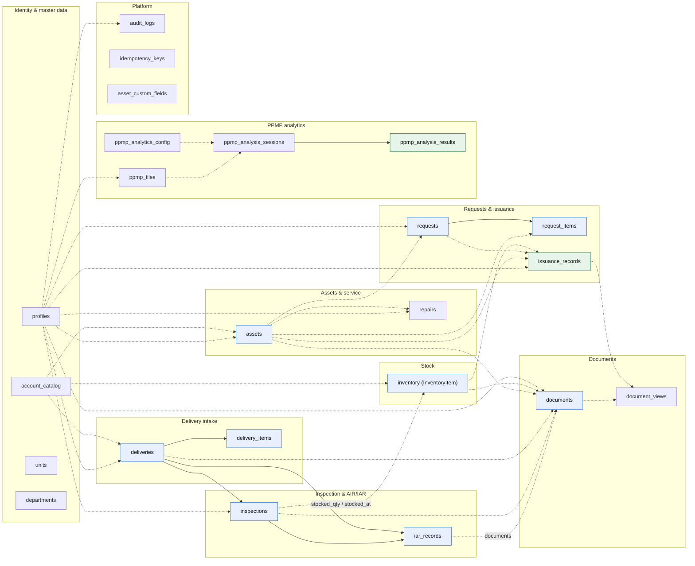

# Database diagram (Mermaid)

Paste any block below into <https://mermaid.live> (or a Mermaid-enabled Markdown
viewer) to render it. The source of truth is `prisma/schema.prisma`; the entity names
here are the Prisma model names, and the attribute comments show the physical table.

Two kinds of connection exist in this database:

- **Enforced** — a real Postgres foreign key created by a Prisma `@relation`.
- **Logical** — a UUID/string column that the app joins in code but Postgres does not
  constrain (for example `assets.assigned_to → profiles.id`). Mermaid's ER syntax only
  draws solid lines, so logical edges are labelled `soft` in Diagram 1 and listed in the
  reference table at the bottom.

## 1. Full ER diagram (all 23 tables)

```mermaid
erDiagram
    %% ---------- Identity ----------
    PROFILE {
        uuid id PK "mirrors auth.users.id"
        varchar full_name
        varchar role "employee | pgso_personnel | super_admin"
        varchar status "active | pending | inactive"
        varchar position
        varchar office
        varchar prefix
        varchar first_name
        varchar middle_name
        varchar last_name
        varchar suffix
        varchar employee_no UK
        varchar department
        bool profile_completed
        timestamptz profile_completed_at
        timestamptz created_at
    }

    %% ---------- Assets ----------
    ASSET {
        uuid id PK
        varchar property_number UK
        varchar qr_code UK
        varchar identifier
        varchar account_code
        varchar account_title
        varchar account_name
        varchar category
        varchar article
        int quantity
        varchar unit
        text description
        date date_acquired
        varchar location
        decimal total_cost
        decimal unit_cost
        varchar condition
        varchar status "available | assigned | ..."
        varchar end_user
        varchar brand
        int cylinders
        varchar engine_displacement
        varchar fuel_type
        varchar engine_number
        varchar chassis_number
        varchar color
        varchar plate_number
        varchar fund
        varchar dv_tracking_number
        varchar supplier_payee
        varchar account_name_charge
        varchar account_number
        varchar obr_number
        varchar dv_number
        date date_received
        uuid assigned_to FK "soft -> profiles.id"
        jsonb custom_fields
        timestamptz created_at
    }

    ASSET_CUSTOM_FIELD {
        uuid id PK
        varchar field_key UK
        varchar label
        varchar field_type
        uuid created_by FK "soft -> profiles.id"
        timestamptz created_at
    }

    %% ---------- Deliveries / inspection / AIR-IAR ----------
    DELIVERY {
        uuid id PK
        varchar po_reference
        varchar supplier
        date date_delivered
        date expected_arrival_date
        varchar delivery_kind
        varchar delivery_status
        varchar inspection_status
        uuid received_by FK "soft -> profiles.id"
        varchar recipient_role
        varchar recipient_name
        varchar asset_type
        varchar account_code FK "soft -> account_catalog.account_code"
        varchar account_title
        timestamptz created_at
    }

    DELIVERY_ITEM {
        uuid id PK
        uuid delivery_id FK
        varchar item_name
        varchar unit
        int quantity
        decimal unit_cost
        int stocked_qty "high-water mark"
        timestamptz created_at
    }

    INSPECTION {
        uuid id PK
        uuid delivery_id FK
        uuid inspector_id FK "soft -> profiles.id"
        varchar inspector_name
        date inspection_date
        varchar result "passed | partial | failed"
        text remarks
        jsonb supplier_checks
        jsonb item_checks
        uuid air_document_id FK "soft -> documents.id"
        varchar iar_no
        date iar_date
        varchar iar_invoice_no
        date iar_invoice_date
        jsonb iar_data "immutable snapshot"
        timestamptz iar_generated_at
        text iar_image_url
        timestamptz stocked_at
        timestamptz created_at
    }

    IAR_RECORD {
        uuid id PK
        uuid inspection_id FK
        uuid delivery_id FK
        varchar kind "AIR | IAR"
        varchar iar_no
        date iar_date
        varchar iar_invoice_no
        date iar_invoice_date
        jsonb iar_data "immutable snapshot"
        text iar_image_url
        timestamptz created_at
    }

    %% ---------- Stock ----------
    INVENTORY_ITEM {
        uuid id PK
        varchar item_name
        varchar category
        varchar account_code FK "soft -> account_catalog.account_code"
        varchar delivery_kind
        int quantity
        varchar unit
        decimal unit_cost
        decimal total_cost
        int reorder_threshold
        varchar location
        jsonb custom_fields
        timestamptz updated_at
    }

    %% ---------- Documents / issuance ----------
    DOCUMENT {
        uuid id PK
        varchar document_type "AIR | IAR | PAR | ICS | ..."
        varchar reference_number UK
        uuid related_asset_id FK
        uuid related_inventory_id FK
        uuid related_delivery_id FK
        uuid related_inspection_id FK
        uuid related_iar_record_id FK
        varchar status
        text file_url
        date date_created
        uuid prepared_by FK "soft -> profiles.id"
        uuid approved_by FK "soft -> profiles.id"
        timestamptz created_at
    }

    DOCUMENT_VIEW {
        uuid id PK
        varchar doc_type
        uuid doc_id FK "polymorphic: documents | issuance_records"
        uuid viewer_id FK "soft -> profiles.id"
        timestamptz viewed_at
    }

    ISSUANCE_RECORD {
        uuid id PK
        varchar doc_type "PAR | ICS"
        varchar doc_no
        date doc_date
        uuid asset_id FK "soft -> assets.id"
        uuid inventory_id FK "soft -> inventory.id"
        uuid employee_id FK "soft -> profiles.id"
        uuid request_id FK "soft -> requests.id"
        int quantity
        decimal unit_cost
        decimal total_amount
        jsonb issuance_data "immutable lines snapshot"
        text image_url
        uuid created_by FK "soft -> profiles.id"
        timestamptz created_at
    }

    %% ---------- Requests ----------
    REQUEST {
        uuid id PK
        uuid employee_id FK "soft -> profiles.id"
        uuid recipient_id FK "soft -> profiles.id"
        varchar request_type "assignment | repair | ..."
        uuid asset_id FK "soft -> assets.id"
        text description
        varchar status "pending | approved | rejected | completed"
        timestamptz date_requested
        timestamptz date_resolved
    }

    REQUEST_ITEM {
        uuid id PK
        uuid request_id FK
        uuid asset_id FK "soft -> assets.id"
        text description
        int quantity
        decimal unit_cost
        timestamptz created_at
    }

    %% ---------- Repairs ----------
    REPAIR {
        uuid id PK
        uuid asset_id FK "soft -> assets.id"
        uuid reported_by FK "soft -> profiles.id"
        date repair_date
        text description
        varchar status
        decimal cost
        varchar technician
        uuid created_by FK "soft -> profiles.id"
        timestamptz created_at
    }

    %% ---------- Master data ----------
    UNIT {
        uuid id PK
        varchar name UK
        varchar abbreviation
        varchar status
        uuid created_by FK "soft -> profiles.id"
        timestamptz created_at
    }

    DEPARTMENT {
        uuid id PK
        varchar name UK
        text description
        varchar status
        uuid created_by FK "soft -> profiles.id"
        timestamptz created_at
    }

    ACCOUNT_CATALOG {
        uuid id PK
        varchar account_code UK
        varchar account_title
        varchar account_name
        varchar asset_type
        text description
        varchar status
        uuid created_by FK "soft -> profiles.id"
        timestamptz created_at
    }

    %% ---------- PPMP ----------
    PPMP_FILE {
        uuid id PK
        varchar filename
        text storage_path
        int file_size
        varchar mime_type
        uuid created_by FK "soft -> profiles.id"
        text file_hash
        int fiscal_year
        varchar fiscal_year_source
        int row_count
        jsonb sheet_meta
        varchar status
        timestamptz created_at
        timestamptz updated_at
    }

    PPMP_ANALYTICS_CONFIG {
        int version PK
        float qty_increase_pct
        float cost_increase_pct
        float anomaly_z
        float trend_epsilon_pct
        int forecast_min_history
        float smoothing_alpha
        uuid updated_by FK "soft -> profiles.id"
        timestamptz updated_at
    }

    PPMP_ANALYSIS_SESSION {
        uuid id PK
        uuid user_id FK "soft -> profiles.id"
        varchar preset
        jsonb filters
        jsonb file_ids "soft -> ppmp_files.id[]"
        jsonb file_hashes
        varchar parser_version
        int config_version FK "soft -> ppmp_analytics_config.version"
        varchar stage
        varchar status
        varchar error_code
        timestamptz created_at
        timestamptz completed_at
    }

    PPMP_ANALYSIS_RESULT {
        uuid session_id PK "soft 1:1 -> ppmp_analysis_sessions.id"
        jsonb overview
        jsonb quarterly
        jsonb file_insights
        jsonb yoy
        jsonb trends
        jsonb anomalies
        jsonb costs
        jsonb forecasts
        jsonb recommendations
        jsonb limitations
        jsonb config
        timestamptz created_at
    }

    %% ---------- Platform ----------
    AUDIT_LOG {
        uuid id PK
        uuid user_id FK "soft -> profiles.id"
        varchar action
        varchar module
        jsonb details
        timestamptz created_at
    }

    IDEMPOTENCY_KEY {
        varchar key PK
        varchar operation
        varchar status "processing | done | failed"
        jsonb response
        timestamptz created_at
        timestamptz updated_at
    }

    %% ===== Enforced foreign keys (Prisma @relation) =====
    DELIVERY     ||--o{ DELIVERY_ITEM : "delivery_id"
    DELIVERY     ||--o{ INSPECTION    : "delivery_id"
    DELIVERY     ||--o{ IAR_RECORD    : "delivery_id"
    INSPECTION   ||--o{ IAR_RECORD    : "inspection_id"
    REQUEST      ||--o{ REQUEST_ITEM  : "request_id"
    ASSET        |o--o{ DOCUMENT      : "related_asset_id"
    INVENTORY_ITEM |o--o{ DOCUMENT    : "related_inventory_id"
    DELIVERY     |o--o{ DOCUMENT      : "related_delivery_id"
    INSPECTION   |o--o{ DOCUMENT      : "related_inspection_id"
    IAR_RECORD   |o--o{ DOCUMENT      : "related_iar_record_id"

    %% ===== Logical connections (app-enforced, soft) =====
    PROFILE      |o--o{ ASSET               : "soft: assigned_to"
    PROFILE      ||--o{ DELIVERY            : "soft: received_by"
    PROFILE      |o--o{ INSPECTION          : "soft: inspector_id"
    PROFILE      |o--o{ REPAIR              : "soft: reported_by"
    PROFILE      |o--o{ REPAIR              : "soft: created_by"
    PROFILE      |o--o{ REQUEST             : "soft: employee_id"
    PROFILE      |o--o{ REQUEST             : "soft: recipient_id"
    PROFILE      |o--o{ ISSUANCE_RECORD     : "soft: employee_id"
    PROFILE      |o--o{ ISSUANCE_RECORD     : "soft: created_by"
    PROFILE      |o--o{ DOCUMENT            : "soft: prepared_by"
    PROFILE      |o--o{ DOCUMENT            : "soft: approved_by"
    PROFILE      |o--o{ DOCUMENT_VIEW       : "soft: viewer_id"
    PROFILE      |o--o{ AUDIT_LOG           : "soft: user_id"
    PROFILE      |o--o{ PPMP_FILE           : "soft: created_by"
    PROFILE      |o--o{ PPMP_ANALYSIS_SESSION : "soft: user_id"
    PROFILE      |o--o{ PPMP_ANALYTICS_CONFIG : "soft: updated_by"
    PROFILE      |o--o{ ASSET_CUSTOM_FIELD  : "soft: created_by"
    PROFILE      |o--o{ UNIT                : "soft: created_by"
    PROFILE      |o--o{ DEPARTMENT          : "soft: created_by"
    PROFILE      |o--o{ ACCOUNT_CATALOG     : "soft: created_by"

    ASSET        |o--o{ REPAIR              : "soft: asset_id"
    ASSET        |o--o{ REQUEST             : "soft: asset_id"
    ASSET        |o--o{ REQUEST_ITEM        : "soft: asset_id"
    ASSET        |o--o{ ISSUANCE_RECORD     : "soft: asset_id"
    INVENTORY_ITEM |o--o{ ISSUANCE_RECORD   : "soft: inventory_id"
    REQUEST      |o--o{ ISSUANCE_RECORD     : "soft: request_id"
    DOCUMENT     |o--o{ INSPECTION          : "soft: air_document_id"
    DOCUMENT     |o--o{ DOCUMENT_VIEW       : "soft: doc_id (polymorphic)"
    ISSUANCE_RECORD |o--o{ DOCUMENT_VIEW    : "soft: doc_id (polymorphic)"

    ACCOUNT_CATALOG |o--o{ ASSET            : "soft: account_code"
    ACCOUNT_CATALOG |o--o{ INVENTORY_ITEM   : "soft: account_code"
    ACCOUNT_CATALOG |o--o{ DELIVERY         : "soft: account_code"

    PPMP_ANALYTICS_CONFIG |o--o{ PPMP_ANALYSIS_SESSION : "soft: config_version"
    PPMP_FILE     }o--o{ PPMP_ANALYSIS_SESSION : "soft: file_ids[] json"
    PPMP_ANALYSIS_SESSION ||--|| PPMP_ANALYSIS_RESULT : "soft: session_id PK"
```

> Rendering tip: if mermaid.live throws a parse error on a very large graph, use
> Diagram 2 for the readable version and keep Diagram 1 as the exhaustive reference.

## 2. Core workflow map (readable version)

The path a delivery takes, plus where issuance and requests touch it. Solid arrows are
real foreign keys; dashed arrows are app-enforced UUID/string references.

## 3. Connection reference

`Enforced` = a real Postgres FK. `Soft` = app joins on the column only.

### Identity

| From | Column | To | Cardinality | Kind |
| --- | --- | --- | --- | --- |
| `profiles` | `id` | Supabase `auth.users.id` | 1:1 | Soft (cross-schema) |
| `assets` | `assigned_to` | `profiles.id` | many:0..1 | Soft |
| `deliveries` | `received_by` | `profiles.id` | many:1 | Soft (NOT NULL) |
| `inspections` | `inspector_id` | `profiles.id` | many:0..1 | Soft |
| `documents` | `prepared_by`, `approved_by` | `profiles.id` | many:0..1 | Soft |
| `requests` | `employee_id`, `recipient_id` | `profiles.id` | many:0..1 | Soft |
| `issuance_records` | `employee_id`, `created_by` | `profiles.id` | many:0..1 | Soft |
| `repairs` | `reported_by`, `created_by` | `profiles.id` | many:0..1 | Soft |
| `audit_logs` | `user_id` | `profiles.id` | many:1 | Soft |
| `document_views` | `viewer_id` | `profiles.id` | many:0..1 | Soft |
| `units`, `departments`, `account_catalog`, `asset_custom_fields`, `ppmp_files`, `ppmp_analysis_sessions`, `ppmp_analytics_config` | `created_by` / `user_id` / `updated_by` | `profiles.id` | many:0..1 | Soft |

### Delivery → inspection → AIR/IAR → stock

| From | Column | To | Cardinality | Kind |
| --- | --- | --- | --- | --- |
| `delivery_items` | `delivery_id` | `deliveries.id` | many:1 | Enforced, `ON DELETE CASCADE` |
| `inspections` | `delivery_id` | `deliveries.id` | many:1 | Enforced |
| `iar_records` | `delivery_id` | `deliveries.id` | many:1 | Enforced, `ON DELETE CASCADE` |
| `iar_records` | `inspection_id` | `inspections.id` | many:1 | Enforced, `ON DELETE CASCADE` |
| `inspections` | `air_document_id` | `documents.id` | many:0..1 | Soft |
| `deliveries` | `account_code` | `account_catalog.account_code` | many:0..1 | Soft (code match) |
| `delivery_items` | `stocked_qty` | `inventory.quantity` | — | Derived in `src/lib/stock.ts`, no FK |

### Documents

| From | Column | To | Cardinality | Kind |
| --- | --- | --- | --- | --- |
| `documents` | `related_asset_id` | `assets.id` | many:0..1 | Enforced, `ON DELETE SET NULL` |
| `documents` | `related_inventory_id` | `inventory.id` | many:0..1 | Enforced, `SET NULL` |
| `documents` | `related_delivery_id` | `deliveries.id` | many:0..1 | Enforced, `SET NULL` |
| `documents` | `related_inspection_id` | `inspections.id` | many:0..1 | Enforced, `SET NULL` |
| `documents` | `related_iar_record_id` | `iar_records.id` | many:0..1 | Enforced, `SET NULL` |
| `document_views` | `doc_id` + `doc_type` | `documents.id` / `issuance_records.id` | many:1 | Soft (polymorphic, no FK) |

### Requests, repairs, issuance

| From | Column | To | Cardinality | Kind |
| --- | --- | --- | --- | --- |
| `request_items` | `request_id` | `requests.id` | many:1 | Enforced, `ON DELETE CASCADE` |
| `request_items` | `asset_id` | `assets.id` | many:0..1 | Soft |
| `requests` | `asset_id` | `assets.id` | many:0..1 | Soft |
| `repairs` | `asset_id` | `assets.id` | many:1 | Soft |
| `issuance_records` | `asset_id` | `assets.id` | many:0..1 | Soft |
| `issuance_records` | `inventory_id` | `inventory.id` | many:0..1 | Soft |
| `issuance_records` | `request_id` | `requests.id` | many:0..1 | Soft |
| `issuance_records` | `issuance_data.lines` | `assets.id` / `inventory.id` | JSON snapshot | Soft (append-only) |

### PPMP

| From | Column | To | Cardinality | Kind |
| --- | --- | --- | --- | --- |
| `ppmp_analysis_sessions` | `id` | `ppmp_analysis_results.session_id` | 1:1 (shared PK) | Soft |
| `ppmp_analysis_sessions` | `config_version` | `ppmp_analytics_config.version` | many:0..1 | Soft |
| `ppmp_analysis_sessions` | `file_ids[]` (JSONB) | `ppmp_files.id` | many:many | Soft (array, not a join table) |
| `ppmp_files` | `file_hash` | dedup key | — | Index only |

### Standalone

| Table | Notes |
| --- | --- |
| `audit_logs` | Append-only trail; only soft `user_id` link. |
| `idempotency_keys` | No relations; `key` is the PK used by `src/lib/idempotency.ts`. |
| `asset_custom_fields` | Field definitions; values live in `assets.custom_fields` / `inventory.custom_fields` JSONB. |
| `units`, `departments` | Master lists referenced by string name, not by id. |

## 4. Notes and gotchas

1. **No FK to `auth.users`.** Supabase owns that schema, so `profiles.id` is the app-side
   mirror and every `user_id`-style column points at `profiles`.
2. **`profiles` is the hub.** Most tables reference it softly; deleting a profile is
   blocked by app logic, not by constraint.
3. **`document_views` is polymorphic.** The pair `(doc_type, doc_id)` is unique, and a
   second unique key adds `viewer_id`. There is no FK because `doc_id` can target
   different tables.
4. **`account_code` is the natural key.** Assets, inventory, deliveries, and the catalog
   join on the code, while `account_catalog.id` is a surrogate UUID.
5. **JSONB snapshots are intentional.** `inspections.iar_data`, `iar_records.iar_data`,
   and `issuance_records.issuance_data` are immutable copies of what was printed; they
   are not normalized into child tables.
6. **`stocked_qty` is a high-water mark**, not a plain counter — re-processing an
   inspection never double-stocks (`src/lib/stock.ts`).
7. **Cascade map:** deleting a `delivery` cascades to `delivery_items`, `inspections`,
   and `iar_records`; deleting a `document`'s parent sets its relation to `NULL`.
   Deleting a `request` cascades to `request_items`.
