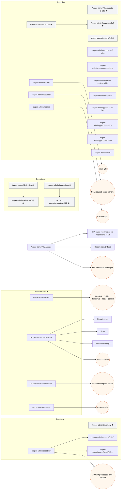
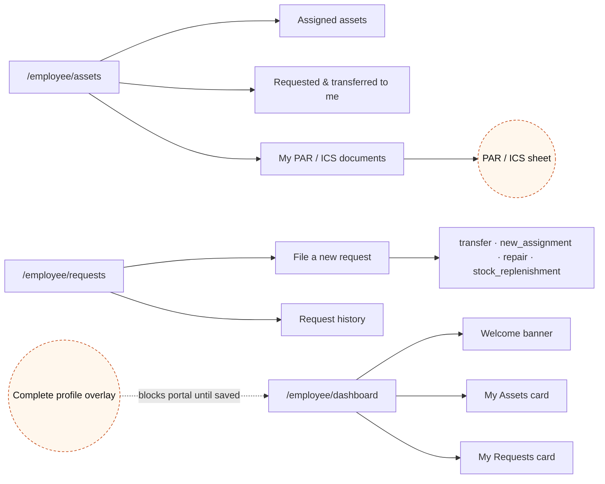
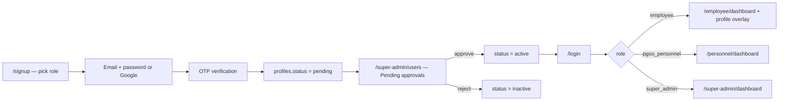
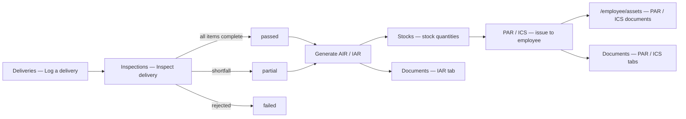
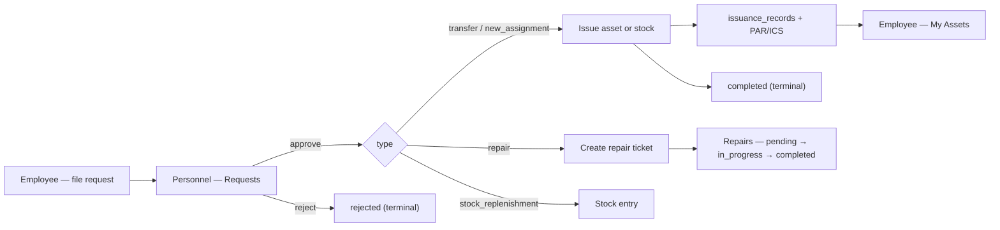
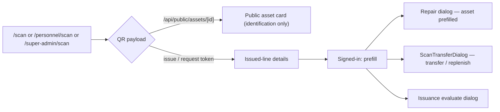
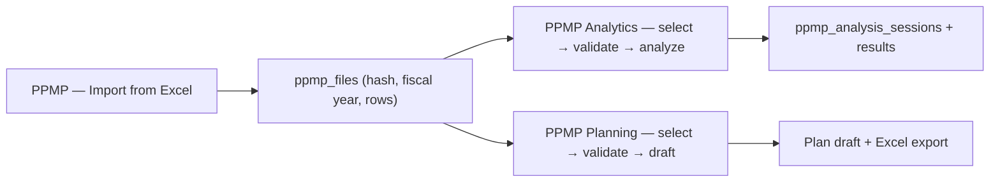
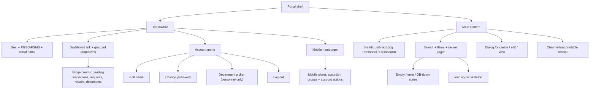

# UI/UX sitemap (Mermaid)

Paste the blocks into <https://mermaid.live>. Routes and labels are taken from
`src/app/**/page.tsx`, the three portal navbars, and `middleware.ts`.

**Legend**

| Symbol | Meaning |
| --- | --- |
| `[ ]` solid node | A real route (`page.tsx`) |
| `(( ))` | Modal / dialog / overlay (no URL) |
| ✅ | Writable by that role |
| 👁 | Read-only for that role |
| ↪ | Redirect-only route |

Portals are hard-partitioned: `pgso_personnel` may only open `/personnel/*`,
`employee` only `/employee/*`, `super_admin` only `/super-admin/*`. A wrong-portal
URL redirects to `/`, which then routes to the correct dashboard.

## 1. Global sitemap

```mermaid
flowchart TD
    subgraph PUBLIC["Public — no session required"]
        HOME["/ — Landing"]
        INFO["/info/[slug] — 13 static articles"]
        SCAN["/scan — Public QR scan"]
    end

    subgraph AUTH["Auth shell — (auth)"]
        LOGIN["/login"]
        SIGNUP["/signup"]
        OTP["OTP step — /signup?step=code"]
        WAIT["Pending approval panel"]
    end

    subgraph EMPLOYEE["Employee portal — /employee/*"]
        ED["Dashboard"]
        EA["My Assets"]
        ER["My Requests"]
        OVERLAY(("Complete profile overlay"))
    end

    subgraph PERSONNEL["Personnel portal — /personnel/*"]
        PD["Dashboard"]
        POPS["Operations"]
        PINV["Inventory"]
        PREC["Records"]
    end

    subgraph ADMIN["Super Admin portal — /super-admin/*"]
        SD["Dashboard"]
        SOPS["Operations"]
        SINV["Inventory"]
        SREC["Records"]
        SADM["Administration"]
    end

    HOME --> LOGIN
    HOME --> SIGNUP
    HOME --> SCAN
    HOME --> INFO

    SIGNUP --> OTP --> WAIT
    WAIT -.->|"Super Admin activates"| LOGIN
    LOGIN -->|"role = employee"| ED
    LOGIN -->|"role = pgso_personnel"| PD
    LOGIN -->|"role = super_admin"| SD

    ED --- OVERLAY
    EA -.-> OVERLAY
    ER -.-> OVERLAY

    PD --- POPS
    PD --- PINV
    PD --- PREC
    POPS --> PDEL["Deliveries"]
    POPS --> PINS["Inspections"]
    PINV --> PSTK["Stocks"]
    PINV --> PAST["Assets"]
    PREC --> PDOC["Documents"]
    PREC --> PISS["PAR / ICS"]
    PREC --> PISS2["Issues"]
    PREC --> PREQ["Requests"]
    PREC --> PREP["Repairs"]
    PREC --> PRPT["Reports"]
    PREC --> PRCM["Recommendations"]
    PREC --> PLOG["Logs"]
    PREC --> PTPL["Templates"]
    PREC --> PPMP["PPMP"]

    SD --- SOPS
    SD --- SINV
    SD --- SREC
    SD --- SADM
    SOPS --> SDEL["Deliveries (read-only)"]
    SOPS --> SINS["Inspections (read-only)"]
    SINV --> SSTK["Stocks (read-only)"]
    SINV --> SAST["Assets"]
    SREC --> SDOC["Documents"]
    SREC --> SPSS["PAR / ICS (read-only)"]
    SREC --> SISS["Issues"]
    SREC --> SREQ["Requests"]
    SREC --> SREP["Repairs"]
    SREC --> SRPT["Reports"]
    SREC --> SRCM["Recommendations"]
    SREC --> SLOG["System logs"]
    SREC --> STPL["Templates"]
    SREC --> SPPMP["PPMP files"]
    SADM --> SUSR["Users"]
    SADM --> SMD["Master Data"]
    SADM --> STRX["Transactions"]
    SADM --> SALL["All Records"]

    classDef public fill:#f3f4f6,stroke:#6b7280,color:#111
    classDef auth fill:#fef3c7,stroke:#b45309,color:#111
    classDef emp fill:#e0f2fe,stroke:#0369a1,color:#111
    classDef per fill:#e6f4ea,stroke:#137333,color:#111
    classDef adm fill:#ede9fe,stroke:#5b21b6,color:#111
    class HOME,INFO,SCAN public
    class LOGIN,SIGNUP,OTP,WAIT auth
    class ED,EA,ER,OVERLAY emp
    class PD,POPS,PINV,PREC,PDEL,PINS,PSTK,PAST,PDOC,PISS,PISS2,PREQ,PREP,PRPT,PRCM,PLOG,PTPL,PPMP per
    class SD,SOPS,SINV,SREC,SADM,SDEL,SINS,SSTK,SAST,SDOC,SPSS,SISS,SREQ,SREP,SRPT,SRCM,SLOG,STPL,SPPMP,SUSR,SMD,STRX,SALL adm
```

## 2. Personnel portal tree

```mermaid
flowchart LR
    ROOT["/personnel"] -->|"↪ redirect"| DASH["/personnel/dashboard"]

    DASH --> D1["KPI cards + monthly chart"]
    DASH --> D2["Recent deliveries / requests / repairs / issuances"]
    DASH --> D3["Low-stock + aging + conditions panels"]

    subgraph OPS["Operations ▾"]
        DEL["/personnel/deliveries"]
        DELD["/personnel/deliveries/[id] — receipt"]
        INS["/personnel/inspections"]
        INSD["/personnel/inspections/[id] — detail"]
        IAR["/personnel/inspections/[id]/iar — AIR/IAR report"]
        RCPT["/personnel/inspections/[id]/receipt — latest receipt"]
        RCPS["/personnel/inspections/[id]/receipts — history receipts"]
    end

    subgraph STOCK["Inventory ▾"]
        INV["/personnel/inventory — Stocks"]
        AST["/personnel/assets"]
        ASTD["/personnel/assets/[id] — asset detail editor"]
        ASTS["/personnel/assets/stock/[id] — ↪ asset detail"]
    end

    subgraph RECS["Records ▾"]
        DOC["/personnel/documents — 8 tabs"]
        ISS["/personnel/issuances — PAR / ICS"]
        ISSD["/personnel/issuances/[id] — accountability report"]
        ISSU["/personnel/issues — issued lines + QR"]
        REQ["/personnel/requests"]
        REP["/personnel/repairs"]
        RPT["/personnel/reports — 3 tabs"]
        RCM["/personnel/recommendations"]
        LOG["/personnel/logs — my activity"]
        TPL["/personnel/templates"]
        PP["/personnel/ppmp"]
        PPA["/personnel/ppmp/analytics"]
        PPP["/personnel/ppmp/planning"]
        SCAN["/personnel/scan"]
    end

    DEL --> DELD
    DEL --> MODAL1(("Log a delivery"))
    DEL --> MODAL2(("Inspect delivery"))
    INS --> INSD
    INS --> MODAL3(("Confirm inspection"))
    INS --> MODAL4(("Generate AIR / IAR"))
    INS --> IAR
    INS --> RCPT
    INS --> RCPS
    AST --> ASTD
    AST --> MODAL5(("Add asset · Import assets · Add column"))
    AST --> MODAL6(("Evaluate issuance"))
    INV --> MODAL7(("Sync from inspections"))
    DOC --> SHEETA(("Receipt / IAR / PAR / ICS sheet"))
    ISS --> ISSD
    ISS --> SHEETA
    ISSU --> MODAL8(("Per-line QR code"))
    REQ --> MODAL9(("New request"))
    REQ --> MODAL10(("Approve · Reject · Issue"))
    REQ --> MODAL11(("Scan transfer / replenish"))
    REP --> MODAL12(("Create / edit / start / complete / reopen repair"))
    REP --> MODAL13(("Repair receipt"))
    RPT --> XLSX1["XLSX export API"]
    PP --> MODAL14(("Import PPMP from Excel"))
    SCAN --> MODAL15(("Scan prefill → repair / transfer"))

    classDef modal fill:#fff7ed,stroke:#c2410c,color:#111,stroke-dasharray:4 3
    class MODAL1,MODAL2,MODAL3,MODAL4,MODAL5,MODAL6,MODAL7,MODAL8,MODAL9,MODAL10,MODAL11,MODAL12,MODAL13,MODAL14,MODAL15,SHEETA modal
```

> Receipts and the IAR report at `/personnel/inspections/[id]/{receipt,receipts,iar}` are
> **chrome-less** — `PersonnelChrome` renders them without the navbar so they print clean.

## 3. Super Admin portal tree

## 4. Employee portal tree

## 5. Cross-portal journeys

### 5.1 Account lifecycle

### 5.2 Delivery → inspection → AIR/IAR → stock → issuance

### 5.3 Request lifecycle

### 5.4 Scan-to-action

### 5.5 PPMP pipeline

## 6. Screen inventory

### Public + auth

| Route | Screen | Key UI |
| --- | --- | --- |
| `/` | Landing | Hero, features, how-it-works, FAQ, footer info links |
| `/info/[slug]` | Static article | 13 slugs (property-tracking, supply-management, analytics-reports, documentation, api-reference, support, blog, roadmap, about, careers, privacy-policy, terms-of-service, contact-us) |
| `/scan` | Public QR scanner | Camera viewport, manual entry, asset/issue/request result card |
| `/login` | Sign in | Email + password, show/hide password, Google OAuth, notices (`pending`, `inactive`, `no-account`, `oauth-error`), `?next=` bounce-back |
| `/signup` | Sign up | Role picker (Employee / PGSO Personnel), Google or email, OTP step, resend code, pending-approval panel |

### Employee

| Route | Screen | Key UI |
| --- | --- | --- |
| `/employee/dashboard` | Dashboard | Welcome banner, My Assets card, My Requests card |
| `/employee/assets` | My Assets | Assigned assets, requested/transferred to me, PAR/ICS documents + sheet modal |
| `/employee/requests` | My Requests | File request form (transfer, new assignment, repair, stock replenishment), recipient picker, history table |
| — | Profile overlay | Blocking modal on first login: prefix, names, suffix, employee no., department, position, office |

### Personnel

| Route | Nav group | Screen | Key UI |
| --- | --- | --- | --- |
| `/personnel/dashboard` | — | Dashboard | KPIs, monthly overview chart, recent deliveries/requests/repairs/issuances, low-stock, aging, conditions, recommendation count |
| `/personnel/deliveries` | Operations | Deliveries | Charts, delivery log table, **Log a delivery** modal, **Inspect delivery** modal |
| `/personnel/deliveries/[id]` | — | Delivery receipt | Printable official copy, toolbar |
| `/personnel/inspections` | Operations | Inspections | Tabs `Inspections` / `AIR`, confirm-inspection dialog, IAR dialog, pager |
| `/personnel/inspections/[id]` | — | Inspection detail | Delivery + inspection records |
| `/personnel/inspections/[id]/iar` | — | AIR/IAR report | Printable sheet, attach/remove image |
| `/personnel/inspections/[id]/receipt` | — | Latest receipt | Printable receipt, view-AIR action |
| `/personnel/inspections/[id]/receipts` | — | Receipt history | Stacked receipts |
| `/personnel/inventory` | Inventory | Stocks | Stock table, recommendations, **Sync from inspections** dialog |
| `/personnel/assets` | Inventory | Assets | Table with QR, add asset, import assets, add custom column, evaluate-issuance dialog |
| `/personnel/assets/[id]` | — | Asset detail | Editable fields, history, QR |
| `/personnel/assets/stock/[id]` | — | ↪ redirects to asset detail | — |
| `/personnel/documents` | Records | Documents | 8 tabs: Delivery, Inspection, Stocks, Assets, Repairs, IAR Reports, PAR, ICS; sheet viewer, search, pager |
| `/personnel/issuances` | Records | PAR / ICS | Table/grid toggle, `All / PAR / ICS` filter, report sheet |
| `/personnel/issuances/[id]` | — | Accountability report | PAR or ICS sheet + toolbar |
| `/personnel/issues` | Records | Issues | Issued lines with per-line QR, completed-request QR records |
| `/personnel/requests` | Records | Requests | Status tabs, new-request dialog, approve/reject/issue dialog, scan transfer, issuance evaluate |
| `/personnel/repairs` | Records | Repairs | Status tabs, create/edit dialogs, start/complete/reopen actions, receipt modal |
| `/personnel/reports` | Records | Reports | Tabs `Aging` / `Quarterly` / `Conditions`, XLSX export |
| `/personnel/recommendations` | Records | Recommendations | Group tabs (all + replenishment / replacement / idle / consumption), priority badges |
| `/personnel/logs` | Records | My activity | Audit trail table, pager |
| `/personnel/templates` | Records | Templates | Download Excel files, blank forms, reference sheets |
| `/personnel/ppmp` | Records | PPMP | Import dialog, cards linking to Analytics and Planning |
| `/personnel/ppmp/analytics` | — | PPMP analytics | Step 1 select files → 2 validate → 3 analyze; charts + insights |
| `/personnel/ppmp/planning` | — | PPMP planning | Step 1 select → 2 validate → 3 build draft; Excel export |
| `/personnel/scan` | Records | QR scanner | Camera, manual entry, prefilled repair/transfer |
| `/personnel/repairs/[id]` | — | ↪ redirects to repairs list | Receipts are modal-only |

### Super Admin

| Route | Nav group | Screen | Difference from personnel |
| --- | --- | --- | --- |
| `/super-admin/dashboard` | — | Dashboard | Org-wide KPIs, deliveries vs inspections chart, recent activity, add-personnel dialog |
| `/super-admin/deliveries` + `/[id]` | Operations | Deliveries | Read-only browse tables with row filters |
| `/super-admin/inspections` + `/[id]` | Operations | Inspections | Read-only |
| `/super-admin/inventory` | Inventory | Stocks | Read-only |
| `/super-admin/assets` + `/[id]` + `/stock/[id]` | Inventory | Assets | Full write (shared dialogs with personnel) |
| `/super-admin/documents` | Records | Documents | All owners, 8 tabs, read-only |
| `/super-admin/issuances` + `/[id]` | Records | PAR / ICS | All owners, read-only |
| `/super-admin/issues` | Records | Issues | All owners (shared table) |
| `/super-admin/requests` | Records | Requests | All owners, new request + scan transfer |
| `/super-admin/repairs` + `/[id]` | Records | Repairs | All owners, create repair |
| `/super-admin/reports` | Records | Reports | Org-wide |
| `/super-admin/recommendations` | Records | Recommendations | Org-wide |
| `/super-admin/logs` | Records | System logs | Every user |
| `/super-admin/templates` | Records | Templates | Same downloads |
| `/super-admin/ppmp` | Records | PPMP files | Every uploaded file + upload |
| `/super-admin/ppmp/analytics` | — | PPMP analytics | Re-exported shared page |
| `/super-admin/ppmp/planning` | — | PPMP planning | Re-exported shared page |
| `/super-admin/scan` | Records | QR scanner | Same scanner |
| `/super-admin/users` | Administration | Users | Pending approvals, all accounts, approve/reject/deactivate, add personnel |
| `/super-admin/master-data` | Administration | Master Data | Departments, Units, Account catalog + catalog import |
| `/super-admin/transactions` | Administration | Transactions | Recent deliveries / requests / repairs / issuances, read-only request dialog |
| `/super-admin/records` | Administration | All Records | Recently registered assets, low-stock watchlist, recent PAR/ICS |

## 7. Layout and interaction patterns

| Pattern | Implementation |
| --- | --- |
| Navigation | Top navbar with hover/click dropdown groups; no sidebar. `Dashboard` is a direct link. |
| Mobile | Hamburger opens a full-height sheet with collapsible groups, account actions, and log out. Body scroll locked while open. |
| Badges | Personnel: pending inspections, requests, repairs, documents. Super Admin adds pending accounts. Capped at `99+`. |
| Account menu | Edit name, change password, department picker (personnel), log out. Employee and Super Admin have no department picker. |
| Page header | Breadcrumb line, title, subtitle, primary action on the right. |
| Lists | Server-side search (`SEARCH_DEBOUNCE_MS = 300`), server pagination (`PAGE_SIZE = 15`), `TablePager`, per-route stale-while-revalidate cache. |
| Tables | Sticky header, selectable rows, inline actions with icon buttons + tooltips, status pills. |
| Detail views | Full page for assets, deliveries, issuances; modal for repairs and document sheets. |
| Printable docs | Chrome-less route for inspection receipts/IAR; print stylesheet; XLSX download buttons. |
| Feedback | Toast notifications for mutations, optimistic rows for request filing, retry buttons on failure, `DbDownNotifier` banner. |
| Loading | Route-level `loading.tsx` skeletons; documents and inspections use per-tab skeletons without flashing the header. |
| Empty states | Panel-level copy ("No accountability documents issued yet."), not blank tables. |
| Access | Middleware blocks pending/inactive (sign-out + `/login?notice=`), wrong portal → `/`, `?next=` restored after login. |
| Redirects | `/personnel` → dashboard; `/personnel/assets/stock/[id]` → asset detail; `/personnel/repairs/[id]` → repairs list. |

## 8. Backend surfaces the UI calls

| Endpoint | Used by |
| --- | --- |
| `/api/public/assets/[id]` | Public `/scan` asset card (identification fields only) |
| `/api/master-data` | Department / unit / catalog pickers |
| `/api/personnel/assets/template-xlsx` | Templates + asset import |
| `/api/personnel/inspections/[id]/air-xlsx` | AIR/IAR report download |
| `/api/personnel/issuances/[id]/par-xlsx`, `ics-xlsx` | PAR / ICS download (personnel) |
| `/api/employee/issuances/[id]/par-xlsx`, `ics-xlsx` | PAR / ICS download (employee) |
| `/api/personnel/ppmp/template-xlsx` | PPMP import template |
| `/api/personnel/reports/[report]`, `/api/super-admin/reports/[report]` | Reports XLSX export |
| `/api/super-admin/master-data/catalog-template-xlsx` | Account catalog import |
| `/api/health` | Health probe |

## 9. Known gaps and rough edges

1. **No portal root pages.** `/employee` and `/super-admin` have no `page.tsx`; only
   `/personnel` redirects to its dashboard. Deep links to the other two roots 404.
2. **`/contact` has no route.** The landing navbar links to `/contact`, but only
   `/info/contact-us` exists.
3. **Receipts are inconsistent.** Deliveries/issuances use dedicated routes; repairs use
   a modal and `/personnel/repairs/[id]` just redirects.
4. **Super Admin has two overlapping summary screens** — `/transactions` and
   `/records` both surface recent operational data, which can confuse which one is
   authoritative.
5. **Personnel "Issues" mixes two concepts** — issued document lines and completed
   request QR records — on one page without a visual divider beyond a panel title.
6. **Reports and Recommendations have no route-level `loading.tsx`**, unlike most list
   pages, so first paint may hold the previous screen longer.
7. **Department is editable by personnel themselves** from the account menu, while
   `profiles.department` is also set through the employee completion overlay — two
   writers for the same field.
