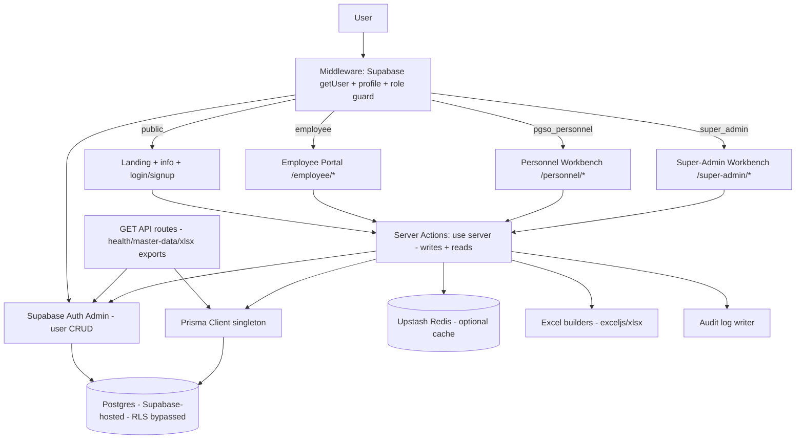

# Web Development Codebase Audit — PGSO-PSMS

> **Project:** PGSO-PSMS (Provincial General Services Office — Property & Supply Management System)
> **Repository:** `PGSO-main` (local workspace)
> **Audit date:** 2026-09-29 (UTC)
> **Auditor role:** Senior full-stack architect / UX / security / documentation review
> **Method:** Static inspection of the actual files, configs, routes, actions, schema, and dependencies. No source code was modified. No runtime/Lighthouse measurements were taken. No secret values are reproduced in this report.
> **Scope note:** The repository contains `.env`, `.env.local`, `.env.local.bak-direct` on disk (git-ignored, untracked — verified via `git ls-files`). Only variable *names* are listed.

---

## 1. Executive Summary

PGSO-PSMS is a **full-stack monolithic Next.js 16 (App Router) + React 19 + TypeScript** application for government property and supply management: asset registry (PPE), consumable inventory/stock, supplier deliveries, inspections with IAR (Inspection and Acceptance Report), PAR/ICS issuances to employees, repairs, employee service requests, QR tracking, PPMP file uploads, audit logs, master data (units/departments/account catalog), dashboards/analytics, and Excel (PAR/ICS/AIR/catalog/asset/PPMP) import/export.

**Current state in one paragraph:** The codebase is a **large, coherent, mostly-implemented internal operations system** (~336 files under `src/`, ~54,000 lines, 54 page routes, 9 GET API routes, ~28 server-action modules, 20 Prisma models, 26 migration steps). Authentication (Supabase Auth email/password + OTP + OAuth PKCE) with three roles (`super_admin`, `pgso_personnel`, `employee`) is **implemented and consistently enforced** in middleware, layouts, server actions, and API routes. Core domain flows (deliver → inspect → stock → issue → repair; employee request → approve → issuance) are **wired end-to-end**. The main gaps are: **no automated test coverage of business logic** (2 trivial `node:test` files only), **no CI/CD, no Dockerfile, no security headers / rate limiting**, **Prisma bypasses Postgres RLS** (row security is app-level only), **no global `not-found`/`error` pages**, a **dangling `/forgot-password` public path** with no matching page, **duplicate heavy dependencies** (exceljs+xlsx, framer-motion+gsap+lenis+motion), **weak DB referential integrity** (most user FKs are loose UUID strings), and **missing indexes** on hot filter columns. UX foundations (loading skeletons on ~40 routes, Radix primitives, Sonner toasts, responsive hooks) are solid but form/a11y polish and empty/error-state consistency need verification pass.

**No critical remotely-exploitable vulnerability was confirmed from static inspection alone**, but the RLS-bypass architecture plus service-role key usage and absent rate limiting / security headers are the highest-priority hardening items (see §12, §20).

---

## 2. Project Overview

| Item | Evidence |
|---|---|
| Project name | `package.json:2` → `"name": "pgso"`, `src/app/layout.tsx:23-30` title `PGSO-PSMS`, `src/config/site.ts` |
| Domain | Government Property & Supply Management + business analytics (`src/app/layout.tsx:27-28` description) |
| Repo layout | `src/` (app/components/config/hooks/lib/types), `prisma/` (schema+migrations+seeds), `public/` (static + xlsx templates), `scripts/` (53 ad-hoc ops scripts), `middleware.ts`, `next.config.ts`, `package.json`, `tsconfig.json`, `eslint.config.mjs`, `postcss.config.mjs` |
| Scale | 336 files under `src/` (190 `.tsx`, 89 `.ts`, 54 `.css`); ~54,319 lines across `.ts/.tsx`; 54 page routes; 5 layouts; 9 GET API routes; ~28 server-action modules; 63 component files; 30 lib files; 10 hooks; 40+ `loading.tsx` skeletons |
| Runtime model | Next.js App Router SSR/RSC + Server Actions; Postgres via Prisma; Supabase Auth; optional Upstash Redis cache; Vercel-linked hosting (`.vercel/project.json`) |
| Roles | `super_admin` → `/super-admin/*`, `pgso_personnel` → `/personnel/*`, `employee` → `/employee/*` (`middleware.ts:130-138`, `src/types/index.ts:17`) |
| README | `README.md` is the **default `create-next-app` boilerplate** — does not describe this project (finding §13/§17) |
| AGENTS/CLAUDE docs | `AGENTS.md`, `CLAUDE.md` present at root (agent guidance, not user docs) |

### High-level architecture map

| Layer | Location | Responsibility |
|---|---|---|
| Frontend (public) | `src/app/page.tsx`, `src/app/info/[slug]/page.tsx`, `src/components/landing/*`, `src/components/layout/*`, `src/components/navbar/*` | Landing, info articles, header/footer/nav |
| Frontend (auth) | `src/app/(auth)/login/page.tsx`, `src/app/(auth)/signup/page.tsx`, `src/app/(auth)/auth.ts`, `src/app/(auth)/oauth-button.tsx` | Email/password + OTP + OAuth UI and flows |
| Frontend (employee) | `src/app/employee/*`, `src/components/employee/*` | Dashboard, my assets, my requests, profile completion overlay |
| Frontend (personnel) | `src/app/personnel/*`, `src/components/personnel/*` | Operations workbench (16+ modules) |
| Frontend (super-admin) | `src/app/super-admin/*`, `src/components/super-admin/*` | Oversight, browse, users, master data, analytics |
| API layer (REST GET) | `src/app/api/*/route.ts` (8) + `src/app/(auth)/auth/callback/route.ts` | Health, master-data JSON, 6 Excel template/export downloads, OAuth callback |
| Mutation layer | ~28 `actions.ts` server-action modules (`'use server'`) | All writes: auth, assets, deliveries, inspections, issuances, repairs, requests, inventory, PPMP, users, master data |
| AuthN/Z enforcement | `middleware.ts`, `src/lib/auth-guard.ts`, `src/lib/personnel-scope.ts`, per-action `getUser()+profile` checks, `src/app/api/personnel/issuances/[id]/guard.ts` | Session validation, role guards, personnel ownership scoping |
| Data layer | `src/lib/prisma.ts` (singleton), `prisma/schema.prisma` (20 models), `prisma/migrations/*` (26 steps) | Postgres access (RLS bypassed — see §12) |
| Cache | `src/lib/redis.ts`, `src/lib/personnel-cache.ts`, `src/lib/client-cache.ts` | Optional Upstash Redis with graceful degrade to direct DB |
| Shared logic | `src/lib/*` (audit, idempotency, stock, inspection/issuance-rules, labels, format, qrcode, *-excel builders, master-data) | Audit trail, idempotency, domain rules, Excel builders, QR |
| State/hooks | `src/hooks/*` (10 hooks) | Action loading, cached actions, debounce, media query, realtime, receipts, theme |
| Types/config | `src/types/index.ts`, `src/config/site.ts` | `UserRole`, domain DTOs, site metadata |

---

## 3. Current Architecture

**Classification: Full-stack modular monolith — SSR (RSC) + Server Actions + thin GET-only REST export layer + Postgres + Supabase Auth. Not SPA, not SSG-first, not microservices, not GraphQL, not serverless-functions-per-endpoint.**



Adapted to the actual codebase (all nodes verified):

- **Request flow:** `middleware.ts:50-160` → Supabase `auth.getUser()` (server-validated, not cookie-only) → `profiles` lookup (`middleware.ts:100-104`) → inactive-block, auth-page bounce, `/` role redirect, per-prefix role guard. Matcher excludes static assets (`middleware.ts:162-165`).
- **Data flow:** RSC pages/layouts call server actions → `supabase.auth.getUser()` → `prisma.profile` role/status check → scoped Prisma query → return DTO to component. Reads are server-side; browser Supabase client (`src/lib/supabase/client.ts`) exists for realtime/QR/scan and password-update flows.
- **Authentication flow:** email/password (`auth.ts:login`), email OTP signup (`auth.ts:signup/verifySignupOtp/resendSignupOtp`), Google OAuth PKCE (`auth.ts:signInWithOAuth` → `/auth/callback` exchange → auto-create/activate profile). See §11.
- **API flow:** Only `GET` handlers; mutations go through Server Actions (10 MB action payload limit in `next.config.ts:7-11` for Excel imports).
- **Database flow:** Prisma singleton (`src/lib/prisma.ts`) with direct `DATABASE_URL` (+ `DIRECT_URL`); **bypasses Supabase RLS** (acknowledged in code comment `auth.ts:277`). Storage-bucket RLS policies exist for `ppmp-files` and IAR images only.
- **External-service flow:** Supabase Auth (session/user admin), Upstash Redis (optional cache, null-safe), no Stripe/email/analytics/payment integrations found.
- **Error handling:** Per-action `try/catch` with `console.error('[scope]', e)` and safe fallbacks (`[]`/`null`/error DTOs); `DbDownNotifier` banner (`src/components/personnel/DbDownNotifier.tsx`); `checkDatabaseStatus` (`src/app/personnel/system/actions.ts`); **no global `error.tsx`/`global-error.tsx` boundary found** (gap — §6).
- **Client/server responsibilities:** Server owns auth, scoping, validation, Excel generation, audit; client owns presentation, optimistic/loading states (`use-action-loading`, skeletons), QR scanning (`jsqr`), charts (`recharts`), animations (`gsap`/`framer-motion`/`lenis`).

---

## 4. Technology Stack

| Technology | Category | Version | Purpose | Where Used | Status |
|---|---|---|---|---|---|
| TypeScript | Language | `^5` | Type safety | Entire `src/` (`strict:true`, `tsconfig.json:7`) | Active |
| Next.js (App Router) | Full-stack framework | `16.3.4` | SSR/RSC, routing, server actions, API routes | `src/app/**`, `middleware.ts`, `next.config.ts` | Active, current-major |
| React / React DOM | UI runtime | `19.2.8` | Components, RSC | All `.tsx` | Active |
| Tailwind CSS v4 + `@tailwindcss/postcss` + `tw-animate-css` | CSS framework | `^4` / `^4.3.3` / `^1.4.0` | Styling, animations | `globals.css`, 54 `.module.css` + utilities | Active |
| Radix Dialog/Popover/Select/Toast | Component primitives | `^1.1.23`/`^2.3.7`/`^1.2.23` | Accessible modal/select/popover/toast | `src/components/ui/*`, issuance/IAR dialogs | Active |
| `clsx` + `tailwind-merge` | CSS utils | `^2.1.1`/`^2.5.2` | Class composition | `src/lib/utils.ts`, UI kit | Active |
| `lucide-react` | Icons | `^1.42.0` | Iconography | Navbars, tables, dialogs | Active |
| `sonner` (+ legacy `toaster.tsx`) | Toasts | `^2.0.8` | User feedback | `src/components/ui/sonner.tsx`, layouts | Active; **duplicate toaster hosts** (see below) |
| `framer-motion` + `motion-dom` + `motion-utils` | Animation | `^13.2.0` | Motion/transitions | Landing/interactions | Active but **overlaps GSAP** |
| `gsap` + `@gsap/react` | Animation | `^3.15.0`/`^2.1.2` | Scroll/hero animation (`src/lib/gsap-*.ts`) | Landing (`Hero`, `HowItWorks`) | Active but **overlaps framer-motion** |
| `lenis` | Smooth scroll | `^1.3.26` | Smooth scrolling | Landing layout | Active (third animation/scroll lib) |
| `recharts` | Charts | `^3.10.1` | Dashboards/analytics | `super-admin/dashboard`, `personnel/dashboard` | Active |
| `react-day-picker` + `date-fns` | Dates | `^10.0.1`/`^4.4.0` | Calendar/date-picker, formatting | `ui/calendar.tsx`, `ui/date-picker.tsx`, `lib/format.ts` | Active |
| `react-responsive` + `use-media-query` | Responsive | `^10.0.1` | Breakpoint hooks | `src/hooks/use-media-query.ts` | Active |
| Supabase (`@supabase/ssr`, `supabase-js`) | Auth (+ Postgres host) | `^0.12.6`/`^2.115.0` | Session, OAuth, Admin user CRUD | `middleware.ts`, `lib/supabase/*`, `(auth)/*`, `super-admin/*/actions.ts` | Active, core |
| Prisma (`prisma` + `@prisma/client`) | ORM | `^5.22.0` | All DB access, migrations, seeds | `prisma/schema.prisma`, `lib/prisma.ts`, all actions | Active, core |
| Postgres | Database | (via Supabase; `provider=postgresql`, `schema.prisma:6`) | System of record (20 tables) | All server actions/routes | Active |
| Upstash Redis (`@upstash/redis`) | Cache | `^1.38.4` | Personnel cache, idempotency backing | `lib/redis.ts`, `lib/personnel-cache.ts` | **Optional** (null-safe degrade) |
| `server-only` | Guard | `^0.0.1` | Prevent client import of server modules | `lib/*`, actions | Active |
| `exceljs` + `xlsx` (SheetJS) | Excel I/O | `^4.4.0`/`^0.18.5` | PAR/ICS/AIR/catalog/asset/PPMP build+parse | `lib/*-excel.ts`, import actions, export routes | Active but **duplicate Excel engines** |
| `qrcode` + `jsqr` | QR | `^1.5.4`/`^1.4.0` | QR render (`lib/qrcode.ts`) + scan (`QrScanner.tsx`) | Assets, requests, scan pages | Active |
| ESLint 9 + `eslint-config-next` | Lint | `^9`/`16.3.4` | `core-web-vitals` + TS rules | `eslint.config.mjs`, `npm run lint` | Configured; no CI run |
| Node built-in test runner | Testing | (`node --test`, `package.json:12`) | 2 unit tests | `src/__tests__/*.test.ts` | Present but **trivial** |
| `tsx` + `dotenv` | Tooling | `^4.23.13`/`^17.4.2` | Seed/debug scripts | `scripts/*.ts` | Dev/ops only |
| Vercel | Hosting | (linked: `.vercel/project.json`) | Deploy target | `next build/start` | Linked; **no `vercel.json`** |
| pnpm/npm lock | Package manager | `package-lock.json` present | Install | root | npm assumed |

### Per-technology notes (condensed)

1. **Next.js 16 + React 19** — used as intended (RSC pages, nested layouts, `loading.tsx`, server actions). No App-Router misuse detected. Version is current-major; no migration pressure.
2. **Supabase Auth** — the identity provider (password, OTP, OAuth). Sensible choice; actively used in ~69 `supabase.auth.*` call sites. Admin SDK (`SERVICE_ROLE`) confined to `super-admin/dashboard/actions.ts:20`, `super-admin/users/actions.ts:26`, `scripts/*` — correct scoping, but key handling needs discipline (never client-exposed; verified server-only).
3. **Prisma 5.22 + Postgres** — sole ORM; 20 models; 26 migrations. Actively used everywhere. Note: Prisma 6.x exists — upgrade is optional, not urgent; Prisma 5 is still supported. No second ORM (good).
4. **Upstash Redis** — correctly optional (`lib/redis.ts:7-27` returns `null` without env; cache helpers warn-and-degrade). Verify production env actually sets it, else caching is silently off.
5. **Duplicate Excel engines (`exceljs` AND `xlsx`)** — both in `dependencies`. `ppmp/actions.ts` parses with ExcelJS; template/export builders mix. Consolidating on one reduces bundle/maintenance. Severity: LOW-MEDIUM (P3).
6. **Duplicate animation stacks (`framer-motion` + `gsap` + `lenis` + `motion-*`)** — three scroll/motion systems for a back-office app. Likely landing-page only; recommend scoping to landing route via dynamic import or standardizing. Bundle/perf implication (§13).
7. **Duplicate toast hosts (`sonner.tsx` + `toaster.tsx`)** — two toast systems in `components/ui`. Recommend one (Sonner). LOW.
8. **No validation library (zod/yup/valibot)** — validation is hand-rolled per action (e.g., Excel row checks, `parseQtyLine`). Works but inconsistent; introducing `zod` for action inputs is a quality opportunity, not a mandate.
9. **No test framework (vitest/jest/playwright)** — only `node:test` with 2 mirror-tests. Biggest toolchain gap (§17).
10. **No CI/CD config, no Dockerfile** — Vercel-linked but no `vercel.json`, no GitHub Actions, no health-check/rollback docs (§18).
11. **No analytics/monitoring/error-tracking/email/payment deps** — none detected; consistent with an internal government tool, but production observability is therefore absent (P1/P2 backlog).

---

## 5. Project Structure

```
PGSO-main/
├── middleware.ts                  # Auth + role gate (166 lines)
├── next.config.ts                 # serverActions 10mb + images remotePatterns
├── package.json / package-lock.json
├── tsconfig.json  (strict, @/* → ./src/*)
├── eslint.config.mjs / postcss.config.mjs
├── prisma/
│   ├── schema.prisma              # 20 models (374 lines)
│   ├── migrations/ (26 dirs: 0_init … 25_employee_profile_completion)
│   └── seeds/personnel-user.sql   # legacy-role manual seed (see §10)
├── public/                        # favicon, logos, *.xls templates, templates/
├── scripts/ (53 ad-hoc .ts)       # seeds, migrations runners, debug/fix/verify
├── src/
│   ├── app/
│   │   ├── layout.tsx + globals.css
│   │   ├── page.tsx               # public landing (redirects authed users)
│   │   ├── info/[slug]/page.tsx   # public articles
│   │   ├── (auth)/login, signup, auth.ts, oauth.ts, oauth-button.tsx, auth/callback/route.ts
│   │   ├── employee/ (dashboard, assets, requests, actions.ts, profile-actions.ts, layout)
│   │   ├── personnel/ (dashboard, assets[+id,+stock], inventory, deliveries[+id],
│   │   │              inspections[+id,+iar,+receipt,+receipts], issuances[+id],
│   │   │              repairs[+id], requests, issues, documents, logs, ppmp,
│   │   │              templates, scan, department/system actions, ~40 loading.tsx)
│   │   ├── super-admin/ (dashboard+analytics+stats, assets, inventory, deliveries,
│   │   │              inspections, issuances, repairs, requests, issues, documents,
│   │   │              logs, records, transactions, users, master-data, scan,
│   │   │              templates, browse/actions, ~20 loading.tsx)
│   │   └── api/ (health, master-data, 6 xlsx export/template GET routes,
│   │             personnel/issuances/[id]/guard.ts)
│   ├── components/ (63 files: ui/*, landing/*, layout/*, navbar/*, account/*,
│   │                employee/*, personnel/*, super-admin/*, templates/*, QrScanner)
│   ├── lib/ (30 files: prisma, supabase/*, auth-guard, personnel-scope, audit,
│   │         idempotency, redis+caches, master-data, rules, excel builders, etc.)
│   ├── hooks/ (10), types/ (2), config/ (2: site.ts, index.ts)
│   └── __tests__/ (2 trivial tests)
├── .vercel/project.json           # linked project (no vercel.json)
├── AGENTS.md / CLAUDE.md / kilo.json / .kilo/
└── logs: dev-server*.log, prod-server*.log, test-queries*.{js,mjs}, db-audit.tmp.cjs
```

**Structure assessment:** Clean App-Router grouping (`(auth)`, role segments), colocated `actions.ts` per domain, shared UI kit + domain components, centralized `lib/` rules/builders. Root-level stray artifacts (`test-queries*.mjs`, `db-audit.tmp.cjs`, `dev-*.log`, `Untitled`, `public/env.download`) should be removed or git-ignored (P3 hygiene).

---

## 6. Sitemap

### Visual sitemap

```
Website (PGSO-PSMS)
├── / (public landing; authed → role dashboard) ............ src/app/page.tsx
├── /info/[slug] (public articles) ......................... src/app/info/[slug]/page.tsx
├── /login ................................................ src/app/(auth)/login/page.tsx
├── /signup ............................................... src/app/(auth)/signup/page.tsx
├── /auth/callback (OAuth exchange, not a page) ........... src/app/(auth)/auth/callback/route.ts
├── /forgot-password (PUBLIC in middleware — NO PAGE FOUND)  ⚠ gap
├── /employee (role: employee)
│   ├── /employee/dashboard .............................. src/app/employee/dashboard/page.tsx
│   ├── /employee/assets ................................. src/app/employee/assets/page.tsx
│   └── /employee/requests ............................... src/app/employee/requests/page.tsx
├── /personnel (role: pgso_personnel; /personnel → index/redirect)
│   ├── /personnel/dashboard
│   ├── /personnel/assets + /[id] + /stock/[id]
│   ├── /personnel/inventory
│   ├── /personnel/deliveries + /[id]
│   ├── /personnel/inspections + /[id] + /[id]/iar + /[id]/receipt + /[id]/receipts
│   ├── /personnel/issuances + /[id]
│   ├── /personnel/repairs + /[id]
│   ├── /personnel/requests · issues · documents · logs
│   └── /personnel/ppmp · templates · scan
├── /super-admin (role: super_admin)
│   ├── /super-admin/dashboard (+ analytics/stats actions)
│   ├── /super-admin/assets + /[id] + /stock/[id]
│   ├── /super-admin/inventory · deliveries[+id] · inspections[+id]
│   ├── /super-admin/issuances[+id] · repairs[+id] · requests
│   ├── /super-admin/issues · documents · logs
│   ├── /super-admin/records · transactions
│   ├── /super-admin/users · master-data
│   └── /super-admin/scan · templates
└── API (all GET)
    ├── /api/health · /api/master-data
    ├── /api/personnel/assets/template-xlsx · /api/personnel/ppmp/template-xlsx
    ├── /api/personnel/inspections/[id]/air-xlsx
    ├── /api/personnel/issuances/[id]/{par-xlsx,ics-xlsx}
    └── /api/super-admin/master-data/catalog-template-xlsx
```

```mermaid
flowchart TD
    Root[/] --> Info[/info/slug]
    Root --> Login[/login]
    Root --> Signup[/signup]
    Login --> EmpD[/employee/dashboard]
    Login --> PerD[/personnel/dashboard]
    Login --> SAD[/super-admin/dashboard]
    EmpD --> EmpA[/employee/assets]
    EmpD --> EmpR[/employee/requests]
    PerD --> PAssets[/personnel/assets]
    PerD --> PInv[/personnel/inventory]
    PerD --> PDel[/personnel/deliveries]
    PerD --> PIns[/personnel/inspections]
    PerD --> PIss[/personnel/issuances]
    PerD --> PRep[/personnel/repairs]
    PerD --> PReq[/personnel/requests]
    PerD --> PDoc[/personnel/documents]
    PerD --> PPpmp[/personnel/ppmp]
    SAD --> SUsers[/super-admin/users]
    SAD --> SMaster[/super-admin/master-data]
    SAD --> SRec[/super-admin/records]
    SAD --> STrans[/super-admin/transactions]
```

### Route table (abridged — full file list verified in discovery)

| Route | Access | Status | Source File | Notes |
|---|---|---|---|---|
| `/` | Public (authed redirects) | Implemented | `src/app/page.tsx` | Role redirect in `middleware.ts:129-138` |
| `/info/[slug]` | Public | Implemented | `src/app/info/[slug]/page.tsx` | Footer/help articles |
| `/login`, `/signup` | Public (authed bounces) | Implemented | `src/app/(auth)/*/page.tsx` | Email+OTP+OAuth |
| `/auth/callback` | Public (OAuth) | Implemented | `src/app/(auth)/auth/callback/route.ts` | Code exchange, profile bootstrap |
| `/forgot-password` | Public per middleware | **NOT IMPLEMENTED — no page file** | `middleware.ts:10` references it | P1 gap; login likely links nowhere or dead-ends |
| `/employee/dashboard|assets|requests` | `employee` | Implemented | `src/app/employee/*/page.tsx` | Scoped to own rows |
| `/personnel/*` (19 modules) | `pgso_personnel` (+ super_admin via shared readers) | Implemented | `src/app/personnel/*/page.tsx` | Ownership-scoped workbench |
| `/super-admin/*` (17 modules) | `super_admin` | Implemented | `src/app/super-admin/*/page.tsx` | Global browse + admin |
| 404 / global error pages | — | **Missing** | No `not-found.tsx`/`error.tsx`/`global-error.tsx` found | P2 gap |

---

## 7. UX Audit

> Basis: static inspection of pages, layouts, navbars/chrome, dialogs, skeletons, toasts, hooks. No browser/Lighthouse run was performed; interaction claims are tied to code evidence.

### What is implemented (positive findings)

- **Role-based chrome:** `EmployeeChrome`/`PersonnelChrome`/`SuperAdminChrome` + dedicated navbars give each role a consistent shell.
- **Loading states:** 40+ `loading.tsx` skeleton routes (personnel, super-admin, employee) — unusually thorough.
- **Feedback:** Sonner toast host (`ui/sonner.tsx`); async `ActionButton`/`SubmitButton` with pending states (`ui/action-button.tsx`, `ui/submit-button.tsx`, `hooks/use-action-loading.ts`).
- **Modals:** Radix-based `IssuanceDialog`, `IarDialog`, `InspectConfirmDialog`, `ChangePasswordDialog` (focus-trap + escape semantics inherited from Radix).
- **Search/filter/pagination:** `TablePager`, `use-debounced-value`, `use-page-size`, per-module filter-option actions (`getAssetFilterOptions`, `getInventoryFilterOptions`, `getIssueFilterOptions`).
- **QR flows:** `QrScanner` (jsqr) + `RequestQrButton` + scan pages for both personnel and super-admin.
- **Print/export:** Receipt hooks/pages (`use-receipt.ts`, `receipt*` pages) + PAR/ICS/AIR Excel downloads.
- **First-login onboarding:** `CompleteProfileOverlay` blocks employee until profile completion (`lib/profile-completion.ts`).

### Issues

| # | Issue | Location | Evidence | User impact | Severity | Recommendation |
|---|---|---|---|---|---|---|
| UX-1 | **Password-reset dead end:** `/forgot-password` is public in middleware but has no page | `middleware.ts:10`; glob shows no `forgot-password/page.tsx` | `middleware.ts:10` vs page glob (absent) | Users locked out with no recovery path | **High** | Implement reset flow (Supabase `resetPasswordForEmail`) or remove the public entry + login link |
| UX-2 | **No global 404/error pages** | `src/app/` (no `not-found.tsx`/`error.tsx`) | Glob for `not-found,error,global-error` → only `loading.tsx` hits | Broken-link/confusing crash UX, default Next error UI | Medium | Add `not-found.tsx` + `error.tsx` per role segment |
| UX-3 | **Dual toast systems** risk double/conflicting toasts | `src/components/ui/sonner.tsx` + `src/components/ui/toaster.tsx` | Both files present | Inconsistent feedback styling | Low | Standardize on Sonner; remove legacy toaster |
| UX-4 | **README is boilerplate**, no user/admin help beyond `/info` articles | `README.md:1-36` | Default create-next-app text | New devs/users lack onboarding docs | Low (docs) | Replace README with real setup/roles guide |
| UX-5 | **Root clutter** (`Untitled`, `public/env.download`, `test-queries*`, `*.log`) suggests unfinished cleanup that can confuse editors/demos | Root listing | `Untitled`, `public/env.download`, `test-queries.js/mjs`, `dev-*.log` | Dev confusion; risk of serving stray files | Low | Delete or git-ignore; audit `public/` |
| UX-6 | **Status-string UX risk:** roles/statuses are free strings (`pending/active/inactive`, inspection `result`, repair `status`) with no shared enum in UI | `schema.prisma` defaults; `lib/constants.ts`, `lib/labels.ts` (partial) | String comparisons scattered in actions/pages | Inconsistent labels/colors, typo-driven dead filters | Medium | Centralize status vocab + badge map; add DB check constraints |
| UX-7 | **Personnel ownership scoping hides legacy NULL rows** (repairs with `created_by=NULL` invisible to personnel) | `src/lib/personnel-scope.ts:13-14` | Code comment admits hiding | "Missing" repairs confusion for personnel | Medium | Backfill owner or show unowned queue explicitly |
| UX-8 | **Heavy landing animation stack** (GSAP+framer-motion+Lenis) may jank on low-end mobile | `lib/gsap-*.ts`, `package.json` motion deps | 4 motion deps | Mobile perf/jank, battery | Low-Med | Scope animation libs to landing via dynamic import; respect `prefers-reduced-motion` |

---

## 8. Current Development Progress

### Methodology

Each domain was scored by verifying: (a) page(s) exist, (b) server-action readers/writers exist and are called, (c) Prisma model + migrations exist, (d) role/scope enforcement exists. "Complete" requires all four. Percentages are **rough, evidence-derived** (implemented domains ÷ total identifiable domains), not time estimates.

### Progress table

| Feature | Status | Evidence | Missing Work | Priority |
|---|---|---|---|---|
| Landing + info articles | Mostly complete | `app/page.tsx`, `info/[slug]/page.tsx`, landing components | Content/polish verification needs browser run | P3 |
| Auth: email/password login | Complete | `auth.ts:login` + `login/page.tsx` | — | — |
| Auth: OTP signup/verify/resend | Complete | `auth.ts:signup/verifySignupOtp/resendSignupOtp` | — | — |
| Auth: OAuth (Google) PKCE + callback | Complete | `auth.ts:signInWithOAuth`, `auth/callback/route.ts` | Provider-config docs | P3 |
| Auth: logout | Complete | `auth.ts:logout` | — | — |
| **Password reset** | **Not implemented** | No page/action; only middleware public-path mention | Full reset flow | **P1** |
| Employee dashboard/assets/requests | Mostly complete | `employee/actions.ts` (7 fns), 3 pages, `profile-actions.ts` | Browser-verify request lifecycle | P2 |
| Personnel assets + stock + custom fields + Excel import | Mostly complete | `personnel/assets/actions.ts` (16 fns), `custom-fields.ts`, template route | Import error-report UX verify | P2 |
| Deliveries + inspections + IAR + AIR export | Mostly complete | `deliveries/actions.ts`, `inspections/actions.ts` (12 fns), `air-xlsx` route | Stock-sync edge cases (`stocked_qty`, `stocked_at`) verify | P2 |
| Issuances (PAR/ICS) + scans + Excel export | Mostly complete | `issuances/actions.ts` (12 fns), `par/ics-xlsx` routes, `guard.ts` | Approval→issuance race/idempotency verify | P2 |
| Repairs | Mostly complete | `repairs/actions.ts` (7 fns), list+detail pages | Legacy NULL-owner backfill (UX-7) | P2 |
| Requests queue (personnel) + QR issues | Mostly complete | `requests/actions.ts` (10 fns), `issues/actions.ts` | `?` Recipient-routing rules doc | P3 |
| Inventory + reorder thresholds + sync | Mostly complete | `inventory/actions.ts` (8 fns) | Threshold alerting (if desired) | P3 |
| Documents hub + views tracking | Mostly complete | `documents/actions.ts` (9 fns), `DocumentView` model | — | P3 |
| PPMP upload/list | Partially complete | `ppmp/actions.ts:importPpmpFromExcel` only; template route exists | List/filter/delete UI actions if needed; storage lifecycle | P2 |
| Logs (personnel-scoped + super-admin global) | Mostly complete | `personnel/logs/actions.ts`, `super-admin/logs/actions.ts` | Retention policy | P3 |
| Master data (units/depts/catalog + Excel import) | Mostly complete | `super-admin/master-data/actions.ts` (11 fns), catalog template route | Unique-conflict UX verify | P2 |
| Users management (approve/reject/role/status) | Mostly complete | `super-admin/users/actions.ts` (6 fns), `dashboard/actions.ts:addPersonnelEmployee` | Pending-queue semantics vs auto-active signup (doc) | P2 |
| Analytics/dashboards + browse + records + transactions | Mostly complete | `dashboard/analytics.ts`, `dashboard/stats.ts`, `browse/actions.ts` (28 fns), `records/actions.ts` | Query perf review (indexes §10) | P2 |
| QR scan pages | Mostly complete | `personnel/scan`, `super-admin/scan`, `QrScanner.tsx` | Device-permission error states verify | P3 |
| Templates pages | Mostly complete | `personnel/templates`, `super-admin/templates`, `TemplatesGrid.tsx` | — | — |
| Health endpoint | Complete (minimal) | `api/health/route.ts` (static ok) | DB/Redis checks | P2 |
| Audit logging | Mostly complete | `lib/audit.ts:writeAuditLog`, per-action calls | Coverage audit (ensure all writes log) | P2 |
| Caching (Redis/personnel/client) | Partially complete | `lib/redis.ts`, `personnel-cache.ts`, `client-cache.ts`; degrade-safe | Prod env verification; invalidation tests | P2 |
| Tests | **Placeholder** | 2 mirror-tests, no business-logic coverage | Full testing program (§17) | **P1** |
| CI/CD, Docker, observability | **Not implemented** | No `.github/`, `Dockerfile`, `vercel.json`, APM | Pipeline + monitoring (§18) | **P1** |

**Approximate implementation: ~82%** (21 of ~26 identifiable domains "Complete/Mostly complete"; password-reset, PPMP depth, cache-prod-proofing, tests, CI/CD outstanding). Basis: file/action/model presence per domain above. Treat as ±10% — browser and data-migration verification could move it.

### Placeholders / dead code signals

- `TODO/FIXME/XXX/HACK/NOT IMPLEMENTED/coming soon` in `src/**`: **0 hits** (clean).
- `mock/dummy/fake/stub` in `src/**`: **0 hits** (no mock data shipped).
- `placeholder/Lorem`: only benign input placeholders + skeleton comments + CSS selectors.
- `console.*` in `src`: **100+ call sites** (mostly `console.error('[scope]', e)` in catch blocks) — acceptable server-side diagnostics but noisy; recommend structured logging (§18).
- Commented-out functionality: none found in sampled files; full-repo scan recommended before refactor.
- Unused routes/components: none confirmed statically; recommend `knip`/coverage pass (P3).
- 53 `scripts/*.ts` debug/fix/verify files are **ops history, not app code** (`tsconfig.json:36` excludes `scripts`) — archive or document; do not ship.

---

## 9. API / Endpoint Audit

> All `route.ts` handlers export **only `GET`**. All writes go through Server Actions. No GraphQL, no webhooks, no REST POST/PUT/PATCH/DELETE routes were found.

| Method | Endpoint | Purpose | Auth | Params/Body | Response | Source | Status |
|---|---|---|---|---|---|---|---|
| GET | `/api/health` | Liveness probe (public) | None (public per `middleware.ts:14`) | — | `{success,data:{status,timestamp}}` | `src/app/api/health/route.ts:3` | Implemented (minimal) |
| GET | `/api/master-data` | Active units + catalog for dropdowns | Any signed-in user (`getUser`, 401 otherwise) | — | JSON lists | `src/app/api/master-data/route.ts:9` | Implemented |
| GET | `/api/super-admin/master-data/catalog-template-xlsx` | Catalog import template download | `super_admin`+active (401/403) | — | `.xlsx` (`buildCatalogTemplateWorkbook`) | `.../catalog-template-xlsx/route.ts:9` | Implemented |
| GET | `/api/personnel/assets/template-xlsx` | Asset import template | personnel/super_admin+active | — | `.xlsx` (`buildAssetTemplateWorkbook`) | `.../assets/template-xlsx/route.ts:8` | Implemented |
| GET | `/api/personnel/ppmp/template-xlsx` | PPMP template + example row | personnel/super_admin+active | — | `.xlsx` | `.../ppmp/template-xlsx/route.ts:82` | Implemented |
| GET | `/api/personnel/inspections/[id]/air-xlsx` | Filled AIR workbook per inspection | `getUser` + fail-closed ownership in `getDeliveryForInspection` | Query: `entity,department,rcCode,fundCluster,iarNo,iarDate,invoiceNo,invoiceDate` | `AIR-{iarNo\|ref}.xlsx` | `.../air-xlsx/route.ts:26` | Implemented |
| GET | `/api/personnel/issuances/[id]/par-xlsx` | Filled Appendix-71 PAR | `denyIssuanceDownload()` (`401` signed-out; `403` employee≠owner) + 404 if not PAR | — | `.xlsx` (`buildParWorkbook`) | `.../par-xlsx/route.ts:28` | Implemented |
| GET | `/api/personnel/issuances/[id]/ics-xlsx` | Filled Appendix-59 ICS | Same guard; 404 if not ICS | — | `.xlsx` (`buildIcsWorkbook`) | `.../ics-xlsx/route.ts:28` | Implemented |
| GET | `/auth/callback` | OAuth code exchange + profile bootstrap + role redirect | Supabase code exchange; open-redirect guarded | Query: `code,next` | Redirect to role dashboard | `src/app/(auth)/auth/callback/route.ts:41` | Implemented |

### Server-action surface (mutation layer — the de-facto API)

| Module | Functions (count) | Auth pattern | Notes/risks |
|---|---|---|---|
| `(auth)/auth.ts` | 5 (`login,signup,verifySignupOtp,resendSignupOtp,logout` + OAuth) | Idempotency (`withIdempotency`) + audit | Hand-rolled input checks; consider zod |
| `employee/actions.ts` | 7 | `requireEmployee` (allows `active\|pending`) | Employee-scoped reads + `createMyRequest` |
| `employee/profile-actions.ts` | 1 | `requireEmployee` | Migration-25 missing handled with logged error |
| `personnel/assets(/custom-fields)` | 16+5 | `getUser`+profile; personnel scope | Excel import parses up to 10 MB; row-level try/catch |
| `personnel/{dashboard,deliveries,inspections,inventory,issuances,repairs,requests,issues,documents,logs,ppmp,department,system}` | ~80 total | Scoped readers; writes audit-logged | Ownership scoping per `personnel-scope.ts` |
| `super-admin/{users,dashboard,inventory,logs,master-data,records,requests,browse}` | ~50 total | `requireSuperAdmin` (throws) | Admin SDK user CRUD; 28 `browse*` readers |

**Per-endpoint checks:** authentication ✓ (all non-health endpoints require session), authorization ✓ (role + ownership guards sampled), validation △ (manual, inconsistent — recommend schema validation), error handling ✓ (safe fallbacks), **rate limiting ✗ absent**, input sanitization △ (manual; Excel parsers need fuzz/row-limit review), response consistency ✓ (`{success,data}` convention in sampled routes), DB ops ✓ (Prisma), external services (Supabase/Redis only), security notes in §12.

---

## 10. Database Audit

- **Technology:** PostgreSQL (Supabase-hosted), accessed via Prisma Client 5.22 (`prisma/schema.prisma:1-9`; `DATABASE_URL` + `DIRECT_URL`).
- **Models:** 20 (see table). **Migrations:** 26 sequential dirs (`0_init` → `25_employee_profile_completion`), each with `migration.sql`. **Seeds:** `prisma/seeds/personnel-user.sql` (manual, legacy `role='personnel'` — stale vs current `pgso_personnel`; do not run as-is).

| Model/Table | Purpose | Relationships | Important Fields | Indexes | Issues |
|---|---|---|---|---|---|
| `Profile`/`profiles` | Users linked to Supabase `auth.users.id` | None in Prisma (DB-level FK to auth) | `id(uuid,PK,no default)`, `role` default `employee`, `status` default `active`, `employee_no` unique, `profile_completed` | Unique on `employee_no` only | **No FK to auth.users in Prisma; no index on `(role,status)`** (hot auth filter); free-string role/status |
| `Asset`/`assets` | PPE registry | `documents[]` | `property_number`+`qr_code` unique, vehicle fields, `custom_fields` JsonB, `assigned_to` loose uuid | Unique x2 | **No index on `(status,category,account_code,assigned_to)`** (filter-heavy list); loose `assigned_to` |
| `Delivery`/`deliveries` | Supplier deliveries | `items[]`, `inspections[]`, `iar_records[]`, `documents[]` | `received_by` (required, loose), `inspection_status` default `pending` | **None** | **Missing index on `received_by`** (ownership filter on every personnel query) — HIGH |
| `DeliveryItem` | Line items | →Delivery Cascade | `stocked_qty` default 0 | `delivery_id` | OK |
| `Inspection` | Inspection results + IAR payload | →Delivery (no cascade), `iar_records[]`, `documents[]` | `iar_data` Json, `iar_image_url`, `stocked_at` | **None** | **Missing `(delivery_id)`, `(inspector_id)`** — HIGH |
| `IarRecord` | Persisted IARs | →Inspection/Delivery Cascade | `kind`, iar fields | `delivery_id`, `inspection_id` | OK |
| `InventoryItem`/`inventory` | Consumables | `documents[]` | `quantity`, `reorder_threshold`, `custom_fields` | **None** | Missing `(category,account_code)` |
| `AssetCustomField` | Dynamic fields | None | `field_key` unique | Unique | OK |
| `Repair` | Repair tickets | None (all loose uuids) | `asset_id!`, `reported_by!`, `status` default `pending` | **None** | **No FK to Asset; missing `(asset_id)`, `(status)`, `(reported_by)`** — MEDIUM-HIGH |
| `Document` | Polymorphic docs (PAR/ICS/IAR links) | 5× SetNull to Asset/Inventory/Delivery/Inspection/IarRecord | `reference_number` unique, `prepared_by!` | Unique only | Missing `(document_type,status)` + per-FK indexes |
| `Request` | Employee requests | `items[]` | `employee_id!`, `recipient_id?`, `status` default `pending` | `recipient_id` | Missing `(employee_id,status)` — HIGH |
| `RequestItem` | Request lines | →Request Cascade | `quantity` default 1 | `request_id` | OK |
| `AuditLog` | Audit trail | None | `id` **no default** (caller must supply uuid), `user_id!`, `action`, `module` | **None** | **Missing `(user_id)`, `(module)`, `(created_at)`**; id-without-default is fragile — MEDIUM |
| `IdempotencyKey` | Duplicate-mutation guard | None | `key` PK, `status` default `processing` | PK | OK; needs TTL/cleanup policy doc |
| `DocumentView` | View tracking | None | Double `@@unique` (`[doc_type,doc_id]` AND `[doc_type,doc_id,viewer_id]`) | `doc_type` | **Redundant unique** — first is subsumed by second; harmless but confusing |
| `IssuanceRecord` | PAR/ICS issuances | None (loose) | `employee_id!`, `doc_type`, links | 5 single-col indexes | Consider composite `(employee_id,doc_type)` + `(request_id)` already single |
| `Unit`/`Department`/`AccountCatalog` | Master data | None | `name`/`account_code` unique, `status` default `active` | Catalog `(asset_type)`, `(status)` | Units/depts lack `(status)` index (minor) |
| `PpmpFile` | PPMP uploads | None | `storage_path` Text, `created_by!` | `created_by` | OK; needs storage lifecycle (orphan cleanup) |

**Cross-cutting DB findings:**

- **Weak referential integrity (by design, but risky):** user/owner links (`received_by`, `employee_id`, `created_by`, `assigned_to`, `inspector_id`, `recipient_id`, `asset_id` in repairs/issuances) are plain UUID strings with **no Prisma relations / no DB FKs**. Deletes of users leave orphans silently; app code must enforce. Recommend documenting the convention + adding FKs (or scheduled orphan checks) for at least `Repair.asset_id`, `IssuanceRecord.asset_id/inventory_id/employee_id`, `Request.employee_id`.
- **N+1 risks:** list+detail patterns (`getAssets`+`getAssetHistory`, browse readers, dashboard snapshots) fetch relations per-row in places; `resolvePersonnelScope` is cached per-request (good — `personnel-scope.ts:61-89`), and snapshot composers thread scope (good comment at `:72-80`). Still, add `include`-batching review + query-count test on dashboards.
- **Missing `updated_at`:** only `InventoryItem.updated_at` and `IdempotencyKey.updated_at` auto-track; other models lack it — audit forensics harder.
- **No RLS on app tables** (only storage policies in `19_ppmp_files/migration.sql:25-39` + IAR bucket policies). All isolation is app-level via Prisma (which uses a privileged connection). Acceptable for monolith **iff** every query is scoped — spot-checked scoping is correct, but a single missed filter exposes cross-user rows. Recommend automated scope-coverage tests + considering RLS defense-in-depth.
- **Migration risk:** 26 linear migrations is healthy; `scripts/apply-migration-*.ts` duplicates some migrations — ensure production applied each once via `prisma migrate`, not scripts. Stale seed role (`personnel` vs `pgso_personnel`) must be fixed before anyone runs it.

---

## 11. Authentication & Authorization

### Implemented flows

| Flow | Evidence | Status |
|---|---|---|
| Email/password login | `auth.ts:login` (`signInWithPassword:137`, `getUser:156`, profile check `:161`, signOut-if-inactive `:171`, auto-activate pending `:180`) | Implemented |
| Email OTP signup/verify/resend | `auth.ts:signup/verifySignupOtp/resendSignupOtp` (`signUp:263`, `verifyOtp type:signup:348`, `auth.resend:423`, upsert active `:280`) | Implemented |
| OAuth PKCE (Google) | `auth.ts:signInWithOAuth` + `auth/callback/route.ts:48-53` (exchange, bootstrap/activate profile `:74-117`, block inactive `:125-128`) | Implemented |
| Logout | `auth.ts:logout` (`signOut:444`) | Implemented |
| Session validation | `middleware.ts:85` uses `getUser()` (server-validated), never `getSession()` alone | Good |
| Open-redirect guards | `safeNext` (`middleware.ts:31-35`), `safeNextParam` (`auth.ts:35-39`), `roleAllowsPath` (both) | Good |
| OAuth `redirectTo` spoof guard | `callbackOrigin()` prefers configured `NEXT_PUBLIC_APP_URL` over headers (`auth.ts:54-70`) | Good |
| Role routing | `roleRoutes` maps in middleware + auth.ts + callback | Implemented |
| Personnel ownership scope | `personnel-scope.ts` (deliveries→`received_by`, inspections→`received_by|inspector_id`, issuances/repairs→`created_by`) | Implemented |
| Super-admin guard | `requireSuperAdmin` (`auth-guard.ts:28-50`, cached) | Implemented |
| Employee guard | `requireEmployee` (`auth-guard.ts:71-97`, allows `active\|pending`) | Implemented |
| Password update | `ChangePasswordDialog` (`getUser`+`signInWithPassword`+`updateUser`) | Implemented (UI-level) |
| Inactive-account blocking | Middleware `:109-116` + login `:171` + callback `:125` | Implemented |
| **Password reset** | **No page/action found** | **Missing (P1)** |

### Potential issues (defensive, evidence-tied)

1. **Client-influenced OAuth role:** signup role travels via short-lived cookie (`SIGNUP_ROLE_COOKIE`, 10-min, `SameSite=lax` — `auth.ts:92-101`) and is re-validated server-side in callback (`parseSignupRole`). Design is reasonable, but **any self-registered user can claim `pgso_personnel`** — if personnel should be staff-only, add approval gate or allowlist. (Policy decision, P1 to confirm.)
2. **Legacy `pending` auto-activation:** middleware treats `pending` as active (`middleware.ts:107-108`) and login/callback auto-flip `pending→active`. Simplifies onboarding but **nullifies any approval queue** — `getPendingEmployees/approveEmployee/rejectEmployee` (`users/actions.ts`) may be vestigial. Confirm intended user-lifecycle; document or remove.
3. **Service-role key scope:** used in `super-admin/dashboard/actions.ts:19-20`, `users/actions.ts:25-26` + 12 `scripts/*.ts`. Server-only (good), but scripts contain hardcoded test emails (`personnel@pgso.com` etc.) — ensure scripts never run against prod with weak passwords.
4. **Loose role/status strings** (no DB enum/check): a typo'd role update could lock users out or escalate silently. Recommend CHECK constraints + shared `UserRole` enum usage end-to-end (`types/index.ts:17` exists — enforce it).
5. **No MFA / no login-attempt throttling / no session-device management** detected — acceptable for internal tool v1, note as roadmap.
6. Secrets handling: keys read via `process.env` server-side; `NEXT_PUBLIC_*` anon key is public-by-design (Supabase). **No secret values are reproduced here.** `.env*` correctly git-ignored (`git ls-files` shows no tracked env files).

---

## 12. Security Audit

> Static, defensive review. Severity is calibrated to exploitability from code evidence, not hype.

| # | Finding | Severity | Location | Evidence | Impact | Recommendation |
|---|---|---|---|---|---|---|
| SEC-1 | **Prisma bypasses Postgres RLS — all row isolation is app-level** | HIGH | `src/lib/prisma.ts`, `auth.ts:277` comment, migrations (no table RLS) | `Prisma bypasses RLS` comment; only storage policies exist | One unscoped query leaks cross-user data | Scope-coverage tests for every action; consider RLS defense-in-depth; least-privilege DB role for app |
| SEC-2 | **No rate limiting** on auth actions, OTP resend, or exports | MEDIUM (HIGH for auth) | `auth.ts` (login/signup/resend), API routes | No `rate-limit`/`upstash/ratelimit` usage found | Credential-stuffing/OTP-abuse/DoS via 10 MB Excel paths | Add Upstash rate limits (already have Redis dep) on login/signup/resend + export routes |
| SEC-3 | **No security headers** (CSP, HSTS, X-Frame-Options, etc.) | MEDIUM | `next.config.ts` (no `headers()`), middleware (no header injection) | Absent | Clickjacking/MIME-sniff/XSS blast-radius larger | Add `headers()` in `next.config.ts`; start with `X-Frame-Options/DENY`, `nosniff`, `referrer-policy`, then CSP |
| SEC-4 | **Idempotency-key design needs review** (`AuditLog.id` has no default; `IdempotencyKey` has no TTL) | MEDIUM | `schema.prisma:265-285` | `AuditLog.id` no `@default`; no cleanup policy | Key-table bloat; fragile audit writes | Default `uuid()` for `AuditLog.id`; document/cron-clean idempotency keys |
| SEC-5 | **Excel import attack surface** (10 MB uploads, row-level parsing, dual parsers) | MEDIUM | `personnel/assets/actions.ts:importAssetsFromExcel`, `ppmp/actions.ts`, `master-data/actions.ts:importCatalogFromExcel` | `bodySizeLimit:10mb`; row `try/catch` at `:1942` | Formula-injection in exported XLSX, zip-bomb/DoS, type-confusion | Row-count caps, cell-count caps, formula-prefix sanitization (`=,+,-,@`), MIME/extension checks, virus-scan roadmap |
| SEC-6 | **Public IAR image reads** (`IAR scans are publicly viewable`) | MEDIUM | Storage migration (`3_iar_attachment/migration.sql:11-28` per discovery) | Public-select policy | Anyone with URL views inspection scans | Confirm intended; else require signed URLs |
| SEC-7 | **Self-registration can mint `pgso_personnel`** (staff role without approval) | MEDIUM* | `auth.ts:signInWithOAuth`, `oauth.ts:12`, callback bootstrap | `SelfRegisterRole='employee'\|'pgso_personnel'` | Privilege baseline higher than least-privilege | *Policy-dependent: gate personnel behind approval/allowlist if staff-only |
| SEC-8 | **Stale seed with weak password pattern** (`personnel@pgso.com`/`personnel123`-style) + legacy role | LOW (escalates if run on prod) | `prisma/seeds/personnel-user.sql:1-41` | Hardcoded demo creds, `role='personnel'` | Accidental prod seed creates known-cred account | Fix role, randomize password, mark `SEED ONLY — never prod`, or delete |
| SEC-9 | **Verbose `console.error` with raw exception objects** across 100+ sites | LOW | All `actions.ts` catch blocks | `console.error('[scope]', e)` | Internal paths/table names in server logs (low risk; logs are server-side) | Sanitize logged fields; structured logger with redaction |
| SEC-10 | **`dangerouslySetInnerHTML`** — one instance | LOW* | `src/components/ui/chart.tsx:83` | Single hit | *Benign if static CSS injection (shadcn chart pattern); verify no user data flows in | Confirm static-only; add comment guard |
| — | XSS via user content | INFORMATIONAL | — | No `dangerouslySetInnerHTML` with user data found; React escapes by default | Low current risk | Keep rule: never render user HTML; add eslint `no-danger` scoped exception |
| — | SQL injection | INFORMATIONAL | — | All DB via Prisma parameterized queries; no `$queryRaw` with interpolation found | Low | Keep ban on raw SQL interpolation |
| — | CSRF | INFORMATIONAL | — | Server Actions + `SameSite=lax` cookie (`auth.ts:96`); no cookie-based REST mutators | Low | Revisit if cookie-authed REST POSTs are added |
| — | Open redirects | INFORMATIONAL | `middleware.ts:31-35`, `auth.ts:35-39`, callback guards | Same-origin absolute-path checks everywhere | Controlled | Keep pattern for every future `next` param |
| — | CORS | INFORMATIONAL | No `cors` config found; same-origin app | N/A internal | — | Define explicit CORS if mobile/external clients arrive |
| — | Dependency vulns | INSUFFICIENT EVIDENCE | `package.json` | No audit DB queried in this review (rule: no vuln claims without evidence) | Unknown | Run `npm audit` + Dependabot/Snyk in CI (P1) |

**What was checked and not found:** hardcoded credentials in `src/` (none found; secrets via env), JWT hand-rolling (delegated to Supabase), file-upload-to-disk (Supabase Storage), `eval`/command injection (none found), debug pages exposing data (scripts are dev-only, excluded from build).

---

## 13. Performance Audit

> No Lighthouse/Core Web Vitals measured (no runtime in this audit). Findings are code-evidence-based risks.

### Confirmed problems (code-evident)

- **Duplicate heavy libs shipped:** `exceljs` + `xlsx`, `framer-motion` + `gsap` + `lenis` + `motion-*`, `recharts`, `react-day-picker`. `src/` is ~54k lines / 336 files; animation+Excel+chart weight dominates bundle risk. Evidence: `package.json:22-53`.
- **Missing DB indexes on hot paths** (§10 table): `deliveries.received_by`, `inspections.delivery_id/inspector_id`, `requests(employee_id,status)`, `repairs(asset_id,status)`, `audit_logs(user_id,module,created_at)`. Personnel lists filter by these on every request.

### Likely problems

- **Dashboard/browse N+1 + unpaginated aggregates:** 28 `browse*` readers + snapshot composers (`getDashboardSnapshot`, `getIarSnapshot`, `getDocumentsSnapshot`) suggest heavy fan-out; per-request scope caching helps (`personnel-scope.ts:61`), but large tables without composite indexes will degrade.
- **10 MB server-action payloads** (`next.config.ts:7-11`) + Excel row loops with per-row DB hits (`importAssetsFromExcel` row catch at `:1942`) — large imports may hit function timeouts on Vercel. Chunk/bulk-insert + background queue recommended.
- **Three font families** (`Geist` + `Geist_Mono` + `Inter` 8 weights — `layout.tsx:6-20`) + `images.unsplash.com` remote images (`next.config.ts:12-19`) — LCP/font-swap cost; verify `next/font` subsetting + `priority` on hero image.
- **Realtime hook** (`use-admin-realtime.ts`) opens Supabase channels per admin view — fine at small scale; needs channel-count review as users grow.

### Potential improvements

- Dynamic-import landing animations/charts/QR scanner (`next/dynamic`, `ssr:false` where appropriate); tree-shake `date-fns` imports; consolidate Excel on one engine; add `bundle-analyzer` to build; enable Redis in prod and verify hit rates; add pagination caps + `revalidate` strategy per dashboard; compress/resize IAR scans before storage.

---

## 14. Accessibility Audit

> Static review against WCAG 2.2 principles via Radix semantics, labels, focus, headings, alt text. No screen-reader/browser run performed.

| # | Issue | Location | WCAG Area | Severity | Recommendation |
|---|---|---|---|---|---|
| A11Y-1 | **Form-label coverage unverified:** placeholders used heavily (`you@example.com`, `e.g. …`, `Pick a date`) — placeholders are not labels | `(auth)/login/page.tsx:100,117`, `signup/page.tsx:137-306`, `IssuanceDialog.tsx`, `IarDialog.tsx` | 1.3.1 Info & Relationships, 3.3.2 Labels | Medium | Verify every input has `<label>`/`aria-label`; add `ui/label.tsx` usage audit |
| A11Y-2 | **Heading hierarchy unverified** across 54 pages (RSC composition risk: multiple `h1`) | All `page.tsx` | 1.3.1, 2.4.6 | Medium | One `h1` per page; lint rule or snapshot test |
| A11Y-3 | **Dialog focus management** relies on Radix defaults (good) but custom `CompleteProfileOverlay` blocker needs focus-trap + escape review | `CompleteProfileOverlay.tsx` | 2.1.1 Keyboard, 2.4.3 Focus Order | Medium | Ensure trap + initial focus + `aria-modal`; test keyboard-only completion |
| A11Y-4 | **QR scanner is inherently visual** — no confirmed text alternative flow described | `QrScanner.tsx`, scan pages | 1.1.1 Non-text Content | Medium | Provide manual-code entry fallback (verify exists) + instructions |
| A11Y-5 | **Chart accessibility** (`recharts` + `chart.tsx` CSS-injection at `:83`) — data-table/aria-summary unverified | Dashboards | 1.1.1, 1.4.x | Low-Med | Add sr-only data tables + `aria-label` summaries for key charts |
| A11Y-6 | **Color-contrast** not determinable statically (Tailwind v4 tokens) | Global | 1.4.3 Contrast | Info | Run axe/Lighthouse a11y pass per role theme (incl. dark mode `use-theme-preference.ts`) |
| A11Y-7 | **Toast announcements** — Sonner `aria-live` defaults assumed; custom `DbDownNotifier` banner needs `role=alert` check | `DbDownNotifier.tsx`, `sonner.tsx` | 4.1.3 Status Messages | Low | Verify live-region roles; test SR announcement |
| A11Y-8 | **Reduced-motion** — GSAP/Lenis smooth-scroll may ignore `prefers-reduced-motion` | Landing motion stack | 2.3.3 Animation from Interactions | Low | Gate animations behind media query |

**Positives:** Radix primitives (correct ARIA/focus baseline), semantic layout shells, `TablePager` (if buttons are real `<button>`s — spot-verify), skeleton `loading.tsx` reduces layout-shift confusion.

---

## 15. Code Quality Audit

**Strengths:** consistent `actions.ts`-per-domain convention; `server-only` guards; per-request `cache()` memoization (`auth-guard.ts:50`, `personnel-scope.ts:24,61`); centralized rules (`inspection-rules.ts`, `issuance-rules.ts`), labels/format, Excel builders; path alias `@/*`; strict TS; flat ESLint (vitals+TS).

| # | Finding | Evidence | Impact | Recommendation |
|---|---|---|---|---|
| Q-1 | **God action modules** (`assets/actions.ts` ~1900+ lines/16 fns; `browse/actions.ts` 28 fns; `requests/actions.ts` 10 fns) | Line counts + fn inventories (§9) | Review/merge pain, test difficulty | Split by subdomain (reads vs writes; import vs CRUD); extract validators |
| Q-2 | **No schema validation layer** — hand checks per action | Absence of zod/yup; `parseQtyLine`, manual Excel guards | Inconsistent errors, drift | Add `zod` for action inputs + Excel row schemas |
| Q-3 | **Stringly-typed domain** (role/status/result/doc_type as `string`) | `schema.prisma` defaults; scattered comparisons | Typo bugs, weak exhaustiveness | DB CHECK constraints + TS unions (`UserRole` exists — extend to statuses) |
| Q-4 | **Broad `catch` + `console.error` + silent fallback** pattern everywhere (100+ sites) | `console.error('[scope]', e)` + `return []/null` | Real failures masked as empty states; log noise | Typed error taxonomy (`AuthError/ScopeError/DbError/ValidationError`) + user-safe messages + empty-vs-error UI distinction |
| Q-5 | **Duplicated readers across personnel/super-admin** (28 `browse*` mirror personnel readers) | `super-admin/browse/actions.ts` vs personnel actions | Drift risk (fix in one, miss in other) | Shared reader core parameterized by scope (already partially done via `resolvePersonnelScope` — finish it) |
| Q-6 | **Dead-ish approval queue vs auto-active signup** (two user-lifecycle models coexist) | `users/actions.ts` approve/reject vs auto-activate in auth/callback/middleware | Confusion, dead UI | Decide lifecycle; deprecate or document |
| Q-7 | **Root + `scripts/` clutter** (53 ad-hoc scripts, logs, `Untitled`, `env.download`, `test-queries*`) | Root/`scripts/` listings | Noise, accidental prod runs | Archive `scripts/` → `scripts/archive/` + README; delete logs/strays; keep only seeded npm-script entries |
| Q-8 | **Boilerplate README + missing ADRs** | `README.md:1-36` | Onboarding cost | Real README (setup, roles, env, migrations, seeds, deploy) + ADRs for RLS-bypass, auto-active, personnel-scope |
| Q-9 | **`any`/loose Json drift** (Json/JsonB payloads: `iar_data`, `issuance_data`, `custom_fields`, `details`) untyped at edges | `schema.prisma` Json fields; `types/index.ts` partial | Runtime shape errors | Versioned DTO types + runtime guards at read/write boundaries |
| Q-10 | **No barrel/lint enforcement against deep imports or circular deps** (not confirmed circular — needs check) | — | Potential cycles as app grows | Add `knip` + `madge`/`eslint-plugin-import` cycle check in CI |

---

## 16. Dependency Audit

| Area | Detail |
|---|---|
| Direct prod deps | 31 (`package.json:22-53`); dev 8 (`:55-67`) |
| Lockfile | `package-lock.json` present (npm). No `pnpm-lock`/`yarn.lock` — single-manager (good) |
| Unused deps (suspected, needs `knip`) | `motion-dom`/`motion-utils` (transitive of framer-motion — possibly direct-unnecessary), one of `exceljs`/`xlsx`, one of `toaster`/`sonner`, `react-responsive` (if `use-media-query` covers all), `@gsap/react` (if GSAP used imperatively) — **confirm before removing** |
| Duplicates solving same problem | Excel ×2, animation ×3-4, toast ×2 (see §4) |
| Outdated/deprecated | No version-age claims without registry check; note `lucide-react@1.42.0` looks anomalous (upstream major is 0.x — verify installed tree with `npm ls lucide-react`; possible typo/mirror); `xlsx@0.18.5` is old-branch SheetJS (known-quirk history — pin + review, do not claim CVE without audit DB) |
| Vulnerabilities | **Not claimed** — run `npm audit`, enable Dependabot, add `npm run audit` to CI (P1) |
| Postinstall | `prisma generate` (`package.json:10`) — correct for Vercel builds |

---

## 17. Testing Audit

| Area | Tests Present | Coverage Evidence | Missing Tests | Priority |
|---|---|---|---|---|
| Unit (utils/rules) | 2 files: `idempotency.test.ts` (key-length mirror), `action-loading.test.ts` (in-flight guard sim) — run via `node --test` (`package.json:12`) | No coverage config/thresholds | Real unit tests for `stock.ts`, `inspection/issuance-rules.ts`, `format.ts`, `labels.ts`, `idempotency.ts`, `qrcode.ts`, Excel builders | **P1** |
| Server actions (auth/scope/CRUD) | None | — | Auth-guard matrix, personnel-scope matrix, per-domain happy/denied paths | **P1** |
| API routes (exports/health) | None | — | 401/403/404 matrix + filename/content-type assertions | P1 |
| Component/UI | None (no vitest/jest/RTL/playwright) | — | Dialogs, pagers, QR fallback, profile overlay, role chrome | P2 |
| E2E (critical journeys) | None | — | Login→dashboard; deliver→inspect→stock→issue; request→approve→issue; import→export | P1 (after unit) |
| Visual/a11y/perf budgets | None | — | axe + Lighthouse CI budgets | P2 |

**Critical untested functionality:** all authorization boundaries (middleware role matrix, `requireSuperAdmin/requireEmployee`, `denyIssuanceDownload`, personnel ownership), Excel import/export round-trips, stock-quantity transitions (`stocked_qty`, `stocked_at`), issuance approval races, OTP/OAuth callbacks. Any refactor before tests is high-risk.

---

## 18. Deployment & DevOps Audit

| Item | Evidence | Status |
|---|---|---|
| Hosting target | `.vercel/project.json` (org+project IDs); `README.md:32-36` Vercel instructions; `next build/start` scripts | Vercel-linked |
| `vercel.json` | Absent | No explicit regions/build/env config — defaults apply |
| Docker | No `Dockerfile`/`compose`/`dockerignore` | Not containerized (fine for Vercel; gap if self-host needed) |
| CI/CD | No `.github/` workflows | **No pipeline** — lint/test/build/migrate unautomated |
| Env management | `.env*` git-ignored (verified untracked); `NEXT_PUBLIC_*` + server keys; `SUPER_ADMIN_*`/`PERSONNEL_*` seed creds in `.env.local` (names only) | Correct ignore; rotate seed creds; document required-vs-optional per env |
| Build config | `next.config.ts` (10 MB actions, image remotePatterns); `postcss.config.mjs`; `tsconfig` strict | Sound |
| Migrations in deploy | `prisma migrate dev`/`db push` scripts exist; no deploy-time `migrate deploy` hook documented | **Define**: `prisma migrate deploy` on release + backup step |
| Health checks | `GET /api/health` static-ok (no DB/Redis probe) | Upgrade to deep check (`prisma.$queryRaw SELECT 1`, Redis ping) + Vercel check wiring |
| Logging | `console.error` scattered; `dev/prod-server*.log` files in repo | Replace with structured logger (pino) + log-drain/Sentry |
| Monitoring/APM/error tracking | None detected | Add Sentry (or equivalent) + uptime monitor |
| Rollback story | Insufficient evidence | Document Vercel rollback + DB migration reversibility |

**Expected deployment flow (reconstructed, not documented in repo):** push → Vercel build (`next build`, `postinstall: prisma generate`) → runtime (`next start`) with `DATABASE_URL/DIRECT_URL` + Supabase keys + (optional) Upstash vars → manual `prisma migrate deploy`. **This flow is inferred — confirm with maintainers; then codify in README + CI.**

---

## 19. Environment Variables

> Names only. No values reproduced. "Required" = code crashes or degrades without it.

| Variable | Purpose | Required | Used In | Sensitive |
|---|---|---|---|---|
| `DATABASE_URL` | Prisma pooled Postgres connection | Yes | `prisma/schema.prisma:7`, all Prisma calls; `.env`, `.env.local`, `.env.local.bak-direct` | **Yes (credential)** |
| `DIRECT_URL` | Prisma direct connection (migrations) | Yes (migrate) | `prisma/schema.prisma:8`; same env files | **Yes** |
| `NEXT_PUBLIC_SUPABASE_URL` | Supabase project URL (public) | Yes | `middleware.ts:56`, `lib/supabase/*`, `super-admin/*/actions.ts`, `scripts/*` | No (public by design) |
| `NEXT_PUBLIC_SUPABASE_ANON_KEY` | Supabase anon key (public) | Yes | Same as above | No (public by design; RLS-dependent) |
| `SUPABASE_SERVICE_ROLE_KEY` | Admin SDK key (bypasses RLS) | Yes for admin user CRUD | `super-admin/dashboard+users/actions.ts`, `scripts/*` | **Yes — server-only, never `NEXT_PUBLIC`** |
| `NEXT_PUBLIC_APP_NAME` | Display name | No | Config/site (observed in `.env.local`) | No |
| `NEXT_PUBLIC_APP_URL` | Canonical origin (OAuth `redirectTo`, QR links) | Recommended (prod) | `auth.ts:58` (`callbackOrigin`), `lib/qrcode.ts:11` | No |
| `UPSTASH_REDIS_REST_URL` / `UPSTASH_REDIS_REST_TOKEN` | Optional cache | No (degrades to DB) | `lib/redis.ts:9-23`; `.env`, `.env.local` | Token **Yes** |
| `SUPER_ADMIN_EMAIL` / `SUPER_ADMIN_PASSWORD` / `SUPER_ADMIN_NAME` | Bootstrap super-admin seed | Ops-only | `.env.local` (+ seed scripts) | **Yes** |
| `PERSONNEL_EMAIL` / `PERSONNEL_PASSWORD` / `PERSONNEL_NAME` | Demo personnel seed | Ops-only | `.env.local` (+ seed scripts) | **Yes** |
| `NODE_ENV` | Prod-vs-dev branches (cookie `secure`, Prisma global) | Framework-set | `auth.ts:97`, `lib/prisma.ts:17` | No |

**Gaps:** no `.env.example` committed (recommend adding with empty placeholders + comments); seed passwords must be rotated and excluded from any shared/stored env files.

---

## 20. Issues & Findings (combined matrix → prioritized backlog)

*Reasoning rule: P0 = active data-loss/breach/broken-core; P1 = auth/data-integrity/testability/deployability blockers; P2 = incomplete features/perf/a11y gaps; P3 = hygiene/duplication/docs.*

| Priority | Area | Issue | Evidence | User Impact | Technical Impact | Recommended Action |
|---|---|---|---|---|---|---|
| P1 | Auth/UX | Password reset missing (`/forgot-password` public, no page) | `middleware.ts:10` vs page glob | Locked-out users unrecoverable | Dead public path | Implement Supabase reset flow + page; test email delivery |
| P1 | Security | RLS bypassed; app-level isolation only | `lib/prisma.ts`, `auth.ts:277`, no table RLS | Cross-user leak on one missed filter | Systemic | Scope-coverage tests; least-privilege DB role; evaluate RLS |
| P1 | Security | No rate limiting (auth/OTP/exports) | No ratelimit usage | Stuffing/OTP-abuse/DoS | Auth endpoint abuse | Upstash rate limits on `login/signup/resend/callback` + exports |
| P1 | Testing | No business-logic tests (2 trivial only) | `src/__tests__/`, `package.json:12` | Regressions undetected | Unsafe refactor | Vitest + action/API matrix + E2E smoke (critical journeys) |
| P1 | DevOps | No CI/CD, no `npm audit` gate, no migrate-deploy hook | No `.github/`, no `vercel.json` | Broken builds ship; vulns linger | Release risk | GH Actions: lint+typecheck+test+build+audit+migrate-docs; Dependabot |
| P1 | Observability | No error tracking/logging/monitoring; static health check | No Sentry; `api/health/route.ts` static | Silent prod failures | Blind ops | Sentry + structured logs + deep health + uptime |
| P1 | Auth policy | Self-registration can mint `pgso_personnel`; `pending` auto-activates (approval queue vestigial) | `oauth.ts:12`, `middleware.ts:107-108`, `users/actions.ts` | Over-privileged baseline | Lifecycle ambiguity | Confirm policy; gate personnel or remove queue UI |
| P2 | DB | Missing indexes on ownership/filter cols | §10 table (`deliveries.received_by`, `inspections.*`, `requests.*`, `repairs.*`, `audit_logs.*`) | Slow lists as data grows | Full scans | Add indexes; verify with `EXPLAIN` on personnel lists |
| P2 | DB | Loose UUID FKs (no relations/constraints) for users/assets/requests links | `schema.prisma` (§10) | Orphans, silent dangling refs | Integrity drift | Add FKs (or orphan-check jobs) incrementally |
| P2 | DB | `AuditLog.id` no default; `DocumentView` redundant unique; no `updated_at` most models | `schema.prisma:265-298` | Fragile writes; forensic gaps | Write failures | Default `uuid()`; drop redundant unique; add `updated_at` |
| P2 | Security | No security headers; public IAR reads; Excel import hardening; stale seed creds | `next.config.ts`, storage migration, `seeds/personnel-user.sql`, import actions | Clickjacking/XSS blast radius; URL-guessable scans; formula-injection | Hardening debt | Headers + signed URLs (or accept-doc) + import caps/sanitization + seed fix |
| P2 | UX | No 404/error pages; status-vocab inconsistency; NULL-owner hidden repairs; QR text fallback unverified | §7 (UX-2/6/7), §14 (A11Y-4) | Confusion, "missing" data | Support load | Add boundaries; centralize statuses; backfill/fallbacks |
| P2 | Perf | Heavy duplicates (Excel×2, motion×3-4); 10 MB action imports; font/image weight; realtime fan-out | `package.json`, `next.config.ts`, `layout.tsx` | Slow loads, import timeouts | Bundle + timeout risk | Consolidate libs; dynamic imports; chunked imports; analyzer |
| P2 | A11y | Labels, headings, focus-trap, charts, toasts, reduced-motion unverified | §14 | Exclusion, SR gaps | Compliance risk | axe pass + keyboard/SR test per role |
| P2 | Docs | Boilerplate README; no `.env.example`; no deploy/runbook/ADRs | `README.md`, §18/19 | Onboarding/deploy errors | Tribal knowledge | Real README + example env + runbook + ADRs |
| P3 | Quality | God modules; no validation lib; Json untyped; personnel/super-admin reader duplication | §15 | Dev velocity, bug drift | Maintainability | Split modules; zod; DTO types; unify readers |
| P3 | Hygiene | Root clutter; 53 stray scripts; dual toasts; `lucide-react` version anomaly; `console.*` noise | Root listing, `scripts/`, `ui/*`, `package.json:39` | Confusion, log noise | Noise | Archive/delete; standardize toast; verify `npm ls`; structured logs |

---

## 21. Prioritized Development Backlog

*(Same items as §20, ordered for execution. Complexity = effort/size, not time.)*

| # | Task | Reason | Dependency | Priority | Complexity |
|---|---|---|---|---|---|
| 1 | Implement password-reset flow + page | Only broken core-auth journey | Supabase email config | P1 | Small |
| 2 | Confirm user-lifecycle policy (auto-active vs approval; personnel self-reg) | Determines queue UI + seed validity | Stakeholder decision | P1 | Small (decision) → Medium (code) |
| 3 | Add scope/auth test matrix (middleware, guards, `denyIssuanceDownload`, ownership) | Proves RLS-bypass isolation | Test runner setup | P1 | Medium |
| 4 | Add rate limiting (auth + OTP + exports) | Abusable endpoints | Redis/prod env confirm | P1 | Small |
| 5 | Add security headers + verify chart `dangerouslySetInnerHTML` static-only | Cheap hardening | — | P1/P2 | Small |
| 6 | Stand up CI (lint+typecheck+test+build+audit) + Dependabot + `npm audit` gate | Release safety | — | P1 | Small |
| 7 | Add Sentry + structured logging + deep `/api/health` + uptime | Blind ops today | Service choice | P1 | Small-Medium |
| 8 | Document + hook `prisma migrate deploy` into release; fix stale seed role; rotate seed creds | Migration/seed risk | — | P1 | Small |
| 9 | Add missing DB indexes (ownership/filter cols) | List perf | — | P2 | Small |
| 10 | Add FKs/orphan-checks for user/asset links; default `AuditLog.id`; clean `DocumentView` unique | Integrity | Migration window | P2 | Medium |
| 11 | Harden Excel imports (row/cell caps, formula sanitization, chunked bulk-insert) | DoS/injection surface | — | P2 | Medium |
| 12 | Decide IAR public-read vs signed URLs | Privacy | Policy | P2 | Small |
| 13 | Add `not-found`/`error` pages per segment; centralize status vocab/badges | UX dead-ends | — | P2 | Small |
| 14 | Backfill or surface NULL-owner repairs; verify QR manual fallback | "Missing" data confusion | Data review | P2 | Small-Medium |
| 15 | Perf pass: consolidate Excel/motion/toast libs; dynamic-import heavy UI; analyzer + budgets | Bundle/timeout risk | — | P2 | Medium-Large |
| 16 | A11y pass: labels, headings, focus, charts, toasts, reduced-motion (axe + keyboard + SR) | Inclusion/compliance | — | P2 | Medium |
| 17 | Write real README + `.env.example` + runbook + ADRs (RLS-bypass, scope, lifecycle) | Onboarding/deploy risk | Decisions from #2/#12 | P2 | Small-Medium |
| 18 | Expand tests: unit (rules/builders) → action/API → E2E critical journeys; coverage thresholds | Regression safety | #3 runner | P1→P2 | Large |
| 19 | Refactor god modules; add zod validation; type Json payloads; unify personnel/super-admin readers | Maintainability | #18 partial | P3 | Large |
| 20 | Hygiene: archive scripts, delete root strays, standardize toast, verify `lucide-react` tree | Noise | — | P3 | Small |

---

## 22. Recommended Roadmap

### Phase 1 — Critical (auth integrity, abuse resistance, release safety, observability)

| Task | Reason | Dependency | Priority | Complexity |
|---|---|---|---|---|
| Password-reset implementation | Broken recovery journey | Email config | P1 | Small |
| User-lifecycle decision (auto-active vs approval; personnel gating) | Over-privilege ambiguity | Stakeholder | P1 | Small→Medium |
| Auth/scope regression tests | Prove app-level isolation (RLS bypass) | Test setup | P1 | Medium |
| Rate limiting on auth/OTP/exports | Stuffing/DoS exposure | Redis confirm | P1 | Small |
| Security headers + CSP groundwork | Clickjacking/XSS radius | — | P1 | Small |
| CI pipeline + audit gate + Dependabot | Ship-safety | — | P1 | Small |
| Sentry/logging/deep-health/uptime | Blind ops | Vendor | P1 | Small-Medium |
| Migration-deploy hook + seed fixes + cred rotation | Release/data risk | — | P1 | Small |

### Phase 2 — Core Completion (data integrity + unfinished depth)

| Task | Reason | Dependency | Priority | Complexity |
|---|---|---|---|---|
| Ownership/filter indexes | List perf at scale | — | P2 | Small |
| FKs/orphan strategy + `AuditLog.id` default + `DocumentView` cleanup | Integrity/forensics | Migration window | P2 | Medium |
| Excel import hardening + chunked bulk inserts | DoS/injection + timeouts | — | P2 | Medium |
| IAR visibility decision (public vs signed) | Privacy | Policy | P2 | Small |
| PPMP depth (list/filter/delete/lifecycle) if required | Only single-action module | Requirements | P2 | Small-Medium |
| Users/approval-queue resolution (per Phase-1 decision) | Dead-or-live UI | Phase-1 decision | P2 | Small |

### Phase 3 — UX (navigation, states, accessibility, usability)

| Task | Reason | Dependency | Priority | Complexity |
|---|---|---|---|---|
| 404/error boundaries per segment | Dead-end UX | — | P2 | Small |
| Status vocabulary + badge centralization | Consistency | — | P2 | Small |
| NULL-owner repair surfacing; QR manual fallback verify | "Missing" data | Data review | P2 | Small-Medium |
| Full a11y pass (labels/headings/focus/charts/toasts/motion) | Inclusion | — | P2 | Medium |
| Landing/README/info-content polish | Onboarding | — | P3 | Small |

### Phase 4 — Performance (optimization and scalability)

| Task | Reason | Dependency | Priority | Complexity |
|---|---|---|---|---|
| Consolidate Excel/motion/toast duplicates; dynamic imports; analyzer budgets | Bundle weight | — | P2 | Medium-Large |
| Dashboard/browse query review (N+1, pagination, `EXPLAIN`) | Scale risk | Indexes (Phase 2) | P2 | Medium |
| Redis-in-prod verification + invalidation tests | Cache actually helping? | Prod env | P2 | Small |
| Font/image tuning (subsets, priority, remote optimization) | LCP | — | P3 | Small |

### Phase 5 — Code Quality (refactoring, testing, documentation)

| Task | Reason | Dependency | Priority | Complexity |
|---|---|---|---|---|
| E2E critical journeys + coverage thresholds | Regression safety | Phase-1 runner | P1-P2 | Large |
| God-module splits + zod + Json DTO types + reader unification | Maintainability | Tests partial | P3 | Large |
| README/runbook/ADRs + `.env.example` | Tribal knowledge | Phase-1/2 decisions | P2 | Small-Medium |
| Hygiene (scripts archive, strays, toast, dep verify, logger) | Noise | — | P3 | Small |

---

## 23. Current-State Summary

**Frontend**

- Implemented: landing + info, auth pages, 3 role workbenches (54 pages), 5 layouts, 40+ loading skeletons, Radix dialogs, toasts, pagers, QR scan, receipts, templates grids, charts.
- Partial: PPMP UI depth; status-vocab consistency; QR fallback/error states (unverified); landing motion perf.
- Missing: `/forgot-password` page; global `not-found`/`error` boundaries.
- Issues: dual toast hosts; heavy animation deps on landing; root clutter confusion.

**Backend**

- Implemented: middleware gate; `requireSuperAdmin`/`requireEmployee`/personnel-scope; ~28 server-action modules covering all domains; audit + idempotency helpers; Supabase Admin user CRUD; optional Redis degrade-safe.
- Partial: validation (manual per-action); error taxonomy (broad catch+console); PPMP beyond import; cache prod-proofing.
- Missing: REST mutators by design (actions only — OK); password-reset backend; rate limiting; background-job story for big imports.
- Issues: god modules; personnel/super-admin reader duplication; lifecycle ambiguity (auto-active vs approval).

**Database**

- Implemented: 20 models, 26 migrations, storage RLS for PPMP/IAR buckets, seed + demo scripts.
- Partial: indexing (core relations OK; ownership/filter cols missing); constraints (uniques OK; checks/FKs sparse).
- Missing: table-level RLS (by architecture); `updated_at` most models; `AuditLog.id` default; documented retention/TTL.
- Issues: loose UUID FKs (orphan risk); redundant `DocumentView` unique; stale seed role.

**API**

- Implemented: 8 GET routes + OAuth callback; role/ownership guards; Excel builders; consistent JSON envelope.
- Partial: health (shallow); master-data (minimal); import robustness.
- Missing: rate limits; deep health; POST/PUT surface (intentionally actions-based — not a gap).
- Issues: 10 MB surface without throttling/caps review.

**UX**

- Implemented: role chrome, skeletons, feedback primitives, filters/pagination, QR, print/export, onboarding overlay.
- Partial: empty/error-state consistency (masked by silent fallbacks); status badges; mobile motion.
- Missing: reset journey; 404/error pages; verified label/heading/focus coverage.
- Issues: §7 table (UX-1…UX-8).

**Security**

- Findings: §12 (SEC-1…SEC-10 + informational). Highest: RLS-bypass architecture, no rate limiting, no security headers. No confirmed active exploit; no secrets reproduced.

**Testing**

- Findings: 2 trivial `node:test` files; zero coverage of auth/scope/CRUD/exports/E2E; no coverage config; no CI. Highest post-auth risk item alongside RLS-bypass proof.

**Deployment**

- Findings: Vercel-linked, no `vercel.json`/Docker/CI; git-ignored envs (good); inferred (undocumented) migrate-deploy flow; shallow health; no APM/logs/uptime. Codify before next prod release.

---

## 24. Final Audit Scorecard

*No single overall score (per requirement). Statuses reflect static evidence only.*

| Area | Status | Evidence |
|---|---|---|
| Architecture | Adequate | Coherent monolith; correct App-Router/RSC/actions use; middleware+scope design sound; RLS-bypass is a conscious trade-off needing proof (§3, §12) |
| Frontend | Adequate | 54 pages + 5 layouts + 40 skeletons + Radix/toasts/pagers/QR implemented; gaps are reset/404/labels (§6-§8) |
| Backend | Adequate | ~28 action modules, guards, audit/idempotency, admin CRUD all present; validation/error-taxonomy need work (§9, §15) |
| API | Adequate | 9 GET endpoints guarded + consistent; shallow health + no throttling (§9, §18) |
| Database | Needs Attention | 20 models/26 migrations solid; missing ownership indexes, loose FKs, no table RLS, stale seed (§10) |
| UX | Needs Attention | Strong foundations; broken reset journey + missing boundaries + unverified a11y states (§7, §14) |
| Accessibility | Insufficient Evidence | Radix baseline good, but labels/headings/focus/SR/contrast need runtime pass — cannot pass from static alone (§14) |
| Security | Needs Attention | Good redirect/session/open-redirect hygiene; offset by RLS-bypass + no rate-limit/headers + public IAR + import surface (§12) |
| Performance | Needs Attention | Duplicate heavy deps + missing indexes + 10 MB import paths; no measurements taken — risks, not verdicts (§13) |
| Testing | Incomplete | 2 mirror-tests; no unit/action/API/E2E/coverage/CI (§17) |
| Deployment | Incomplete | Vercel-linked but no pipeline/config/runbook/monitoring; env hygiene good (§18, §19) |
| Documentation | Needs Attention | Code comments often good; project README/runbook/ADRs/`.env.example` missing (§15, §18) |

---

## Appendix

### A. Key file reference index

- `middleware.ts` — gates; `next.config.ts` — 10 MB actions + images; `package.json` — stack/scripts; `tsconfig.json` — strict + `@/*`; `eslint.config.mjs` — vitals+TS
- `prisma/schema.prisma` — 20 models; `prisma/migrations/` — 26 steps; `prisma/seeds/personnel-user.sql` — stale seed
- `src/app/(auth)/auth.ts`, `oauth.ts`, `auth/callback/route.ts` — auth core
- `src/lib/auth-guard.ts`, `personnel-scope.ts`, `supabase/*`, `prisma.ts`, `audit.ts`, `idempotency.ts`, `redis.ts`, `personnel-cache.ts`, `qrcode.ts`, `*-excel.ts`, `inspection/issuance-rules.ts`, `profile-completion.ts`
- `src/app/api/*/route.ts` + `issuances/[id]/guard.ts` — export/health surface
- `src/app/employee|personnel|super-admin/*/actions.ts` — mutation/read layer
- `src/components/*` (63), `src/hooks/*` (10), `src/types/index.ts`, `src/config/site.ts`
- `src/__tests__/` (2), `scripts/` (53 — archive), `.vercel/project.json`, `.gitignore` (envs ignored ✓)

### B. Mermaid diagrams

Architecture (§3), sitemap flow (§6). Render with any Mermaid renderer (GitHub, mermaid.live, or Mermaid CLI). PDF export notes Mermaid as formatted code blocks with a link to render.

### C. Audit Limitations

1. **No runtime:** no dev/prod server executed, no browser clicks, no Lighthouse/CWV/axe run — perf/a11y/UX-interaction verdicts are code-evidence risks, not measurements.
2. **No secret/prod access:** `.env*` values never read; Supabase dashboard, Vercel settings, prod DB stats, and storage buckets not inspected — RLS/storage policies taken from migration SQL + code comments.
3. **No dependency audit execution:** `npm audit`/`npm ls`/registry not queried (offline rule) — vuln/outdated claims deliberately withheld; run in CI.
4. **Sampling:** ~54k lines cannot be fully line-read in one pass; high-risk files (middleware, guards, auth, schema, routes, lib) fully read; domain actions/pages inventoried + sampled. Full line-by-line review + `knip`/`madge`/coverage recommended as follow-up.
5. **Data-dependent behavior:** stock transitions, import edge cases, realtime, and email deliverability need seeded staging verification.

### D. Reproducibility

Inventory via file globs (`src/app/**/page.tsx|route.ts|layout.tsx|actions.ts`), `grep` (`process.env`, `supabase.auth`, `TODO|FIXME|mock`, `dangerouslySetInnerHTML`, `console.`), `git ls-files` (env tracking check), direct reads (schema, middleware, guards, config, package). Evidence paths cited inline throughout.

---

*End of audit — Markdown deliverable (`web-development-codebase-audit.md`). PDF companion contains identical content with cover page, contents, and section hierarchy.*
